# Kiến trúc đích — GON.org AI Learning Arena

Tài liệu này ánh xạ prototype `apps/gon-web` sang hệ thống production lấy cảm hứng từ **WSIC** (search 768D + Brew) và **FastChat/Arena** (so sánh hai đáp án), đồng thời bổ sung requirement V2.1 về 10+ output ứng viên, trend, dấu chân cá nhân hoá, Journey Fork và render đa định dạng. Đặc tả requirement đầy đủ nằm tại `../../branding/GON-GameOfNurture/07-Product-AI/GON-TRENDING-PERSONALIZED-OUTPUT-REQUIREMENTS.md`. Mô hình level/XP/token chuẩn nằm tại `../../branding/GON-GameOfNurture/07-Product-AI/GON-WHITEPAPER.md` và dùng công thức `gon-level-v1`: `Lv = floor(Lifetime XP / 100)`, không có trần.

> **Trạng thái quản trị — 22/10/2026:** Gate 0 đã được Product Owner phê duyệt và P01 đang IN REVIEW. Các lựa chọn như Next.js, Convex, QStash hay model cụ thể trong tài liệu này là **phương án tham chiếu từ WSIC/prototype**, chưa phải stack production đã khóa. Theo [ADR-0004](docs/01-architecture/adr/ADR-0004-DEFER-PRODUCTION-STACK-LOCK-IN.md), P03 sẽ quyết định bằng ADR/spike riêng. Phạm vi sản phẩm hiện hành để review nằm tại [GON PRD v1.0](docs/02-requirements/GON-PRD-V1.md).

## 1. Luồng nghiệp vụ

```mermaid
flowchart LR
  A[Google OAuth + cổng 18+] --> B[Learning Arena composer]
  B --> C[Ingestion: text/file/ảnh/video/link]
  C --> D[Normalize + OCR/transcript/extraction]
  D --> E[Keyword/entity/intent]
  E --> F[Gemini embedding 768D]
  F --> G{Hybrid search}
  G -->|đủ sát| H[Mở module sẵn có]
  G -->|liên quan| I[Chọn module hoặc Brew biến thể]
  G -->|thiếu| J[Brew Your Topic]
  H --> Q[10+ Output Candidates]
  I --> Q
  J --> L[Queue + ADK 11 bước]
  L --> Q
  Q --> R[Rank: trend + footprint + quality]
  R --> K[Output Arena vote/merge]
  K --> S[Fork Journey Branch]
  S --> T[Render web/GDevelop/infographic/video/task]
  T --> M[Quest/quiz/flashcards + mastery gate]
  M --> N[Lifetime XP → Lv.N · Era ∞]
  M --> O[Proof Vault]
  O --> P[Issuer/on-chain verification khi đủ điều kiện]
  O --> Q
```

## 2. Thành phần đề xuất

| Lớp | Lựa chọn tham chiếu WSIC | Ghi chú GON |
|---|---|---|
| Web | Next.js/React | Giữ Arena composer, stream trạng thái pipeline, không để API key ở client |
| Auth | Google OAuth/Better Auth | Kiểm tra session ở mọi API ghi; chính sách 18+ riêng với đăng nhập |
| DB/realtime | Convex | Project, source, module, interaction, proof, notification; index tách public/private |
| Auth DB (nếu giữ Better Auth như WSIC) | PostgreSQL | Chỉ dữ liệu auth; không nhân bản hồ sơ học tập |
| Queue | Upstash QStash hoặc tương đương | Chữ ký webhook, deadline, retry có idempotency key |
| Orchestrator | Flask/FastAPI trên Render/Cloud Run | Kiểm tra chủ đề trước pipeline đắt tiền |
| Agents | Google ADK trên Cloud Run | SequentialAgent, output schema, state tối thiểu |
| Models | Gemini 2.5 Flash cho nghiên cứu/quyết định; Flash Lite cho tác vụ schema hẹp* | *Chốt model theo quota/giá tại thời điểm triển khai; cấu hình hoá, không hard-code rải rác |
| Embeddings | `gemini-embedding-001`, 768D, `SEMANTIC_SIMILARITY` | Lưu model/version/dimension cùng vector để tái lập chỉ mục |
| Research | Exa/Serper hoặc nhà cung cấp đã duyệt | Lưu URL, thời điểm truy xuất, đoạn trích hỗ trợ từng claim |
| Storage | Object storage có signed URL | Quét malware, giới hạn MIME/dung lượng, chính sách giữ/xoá |
| Event/Feature Platform | Stream + warehouse/feature store | Footprint có consent, trend snapshot, ranking snapshot; tách dữ liệu định danh khỏi analytics |
| Recommendation | Rule-based trước, ML sau khi có dữ liệu | Candidate retrieval 768D/graph/trend, rerank theo learning gain; không dùng engagement-only |
| Journey Graph | DB quan hệ/graph index trên cùng backend | Fork/branch/commit/diff/merge, lineage và attribution bất biến theo version |
| Media/GDevelop Render | Worker hàng đợi | Canonical Module Graph → web, GDevelop project, infographic, image sequence, video brief và task |

## 3. Search contract

Một truy vấn có thể chứa nhiều artifact. Văn bản chuẩn hoá dùng để tìm kiếm gồm: prompt người dùng + OCR/transcript/text trích xuất + metadata được phép, nhưng mỗi thành phần vẫn giữ provenance riêng.

- **Exact/full-text:** tiêu đề, alias, keyword.
- **Vector:** cosine trên vector 768D.
- **Specificity guard:** độ phủ thực thể/từ khóa đặc thù. Đây là bài học từ prototype: hai chủ đề cùng là “học tập” không được coi là trùng khớp chỉ vì embedding chung ngữ cảnh.
- **Phân loại:** `found` (mở ngay), `related` (hiển thị + cho Brew), `missing` (ưu tiên Brew). Ngưỡng production phải hiệu chuẩn bằng tập truy vấn gán nhãn; tài liệu WSIC dùng vùng điểm cao quanh 0.85 cho kết quả mạnh, không mang ngưỡng demo 0.58 lên production.

## 4. Brew: 11 bước và kiểm soát chất lượng

Kế thừa pipeline WSIC nhưng đặt **citation/grounding verification thành cổng bắt buộc**, vì nguồn WSIC hiện chưa tự kiểm chứng từng câu:

1. Research Brief — câu hỏi, phạm vi, nguồn ứng viên.
2. Quiz chẩn đoán.
3. Research Deep — nội dung có claim↔source mapping.
4. Reorder/process challenge.
5. Real-world Impact Quest.
6. Final Quiz/Boss.
7. Flashcards/summary.
8. Category, tags, description.
9. Thumbnail brief (không dùng ảnh không rõ quyền).
10. Assembler — hợp nhất theo schema + safety/provenance gate.
11. Writer — ghi một lần vào DB, phát sự kiện hoàn tất.

Trước pipeline: `topic-checker` chặn input rỗng/lặp/nguy hiểm. Lỗi xác định (invalid topic) không retry; lỗi tạm thời retry tối đa 3 lần. Mọi request có `generation_requests` gồm `idempotency_key`, `user_id`, hash đầu vào, trạng thái, số lần thử, chi phí và lỗi cuối; retry không được tạo module trùng.

## 5. Mô hình dữ liệu tối thiểu

- `users`, `hero_profiles`, `consents`
- `projects` (input gốc là dự án học, không chỉ là lịch sử chat)
- `source_artifacts` (loại, URL/file ref, hash, extraction status, quyền)
- `topics`, `modules`, `blocks` (union kiểu nội dung có schema)
- `embeddings` (vector 768, model, version, source span)
- `generation_requests` (idempotency + pipeline state)
- `interactions` (quest/quiz/flashcard/arena vote)
- `proofs` (issuer, bằng chứng, cấp xác minh, trạng thái thu hồi)
- `notifications`, `audit_events`
- `learning_modes`, `preference_profiles`, `learning_footprints`
- `candidate_outputs`, `output_versions`, `arena_matches`, `arena_votes`, `ranking_snapshots`
- `journey_branches`, `branch_commits`, `branch_merges`, `branch_lineage`
- `trend_snapshots`, `mastery_states`, `creator_attributions`, `reward_ledger`
- `xp_ledger_entries`, `level_snapshots`; nếu có token trong tương lai: `learning_token_ledger` với trường earned/spendable tách riêng
- `media_renders`, `gdevelop_exports`, `game_sessions`

## 6. Proof of Learning không được “tự phong”

| Cấp | Nghĩa | Được hiển thị |
|---|---|---|
| 0 Self-declared | Người dùng tự khai | “Tự khai” |
| 1 Source-linked | Có file/link + hash, chưa đối chiếu chủ sở hữu/issuer | “Đã gắn nguồn” |
| 2 System-recorded | GON tự ghi quiz/quest/module | “GON ghi nhận trong hệ thống” |
| 3 Issuer-verified | Đối chiếu tổ chức/chữ ký/POAP wallet theo quy trình | “Issuer đã đối chiếu” |
| 4 Anchored | Neo POAP/SBT/sổ cái | “Đã neo” + vẫn link provenance off-chain |

Ảnh chứng chỉ, bài Facebook hoặc video YouTube **không tự động** là Issuer-verified. Public profile chỉ hiển thị dữ liệu người dùng đồng ý công khai; dữ liệu y tế/hiến máu nhạy cảm phải tách consent và không dùng để xếp hạng gây áp lực.

## 7. Recommendation, Trend và Journey Fork

Recommender chạy hai tầng: retrieval hợp nhất vector 768D, topic/fork graph, creator/guild, trend và evergreen; reranking kết hợp relevance, personal fit, predicted learning gain, trend đã trọng số theo completion/proof, source quality, creator trust và diversity. Mọi lần xếp hạng lưu feature/ranking snapshot cùng lý do hiển thị cho user. Trend được tính theo cửa sổ thời gian từ learner độc lập hoàn thành, Fork tạo artifact, mastery và proof; view/like/share có trọng số thấp và phải qua anti-bot/quality gate.

Mỗi output/Success Path có version bất biến. Khi user Fork, backend tạo `journey_branch` trỏ về upstream version; các bước học có ý nghĩa thành `branch_commit`; merge phải hiển thị diff concept/nguồn/artifact và xử lý mâu thuẫn thay vì ghi đè âm thầm. Creator Score và mọi reward tương lai đọc từ attribution graph + ledger, ưu tiên downstream mastery/proof hơn tương tác bề mặt. Lifetime XP là sổ cái reputational nội bộ; Numeric Level tính từ Lifetime XP/Lifetime Earned hợp lệ, trong khi số dư token có thể chi tiêu/mua/chuyển nhượng không bao giờ quyết định level.

### 7.1 Hợp đồng Lifelong Numeric Level

- `XP_PER_LEVEL = 100`, `numericLevel = floor(LifetimeXP / 100)`, `xpInLevel = LifetimeXP mod 100`; luôn tồn tại `Lv.N+1`.
- `Era` chỉ là lớp bản sắc: Zero Lv.0, Awaken Lv.1–2, Explorer Lv.3–6, Guardian Lv.7–11, Hero Lv.12–19, Legend Lv.20–34, Forever Lv.35+.
- Mỗi `xp_ledger_entries` có `source_event_id`, `xp_delta`, `lifetime_xp_after`, `formula_version=gon-level-v1`, `rule_version`, `idempotency_key`, trạng thái và liên kết reversal/evidence.
- API/profile phải trả đồng thời `lifetimeXP`, `numericLevel`, `era`, `nextLevelXP`, `remainingXP`, `formulaVersion`; không trả `maxLevel` hay next rỗng vì chạm trần.
- Nếu Learning Token được bật sau phê duyệt pháp lý, phát hành từ cùng sự kiện học có thể làm tăng `lifetimeEarnedToken`; `spendableTokenBalance`, token mua vào và token nhận chuyển nhượng không tham gia tính level. Chi tiêu không demote user.
- Migration prototype: `state.xp` được hiểu là Lifetime XP; 3.500 XP trở thành điểm mở Forever Era ở Lv.35, không phải điểm hoàn tất hành trình.

Module được lưu dưới dạng Canonical Module Graph có schema/version. Worker render cùng graph thành web lesson, project GDevelop, infographic, chuỗi hình ảnh, video script/storyboard và task. Game/GDevelop gửi event đã ký/xác thực về backend; XP/proof chính thức do server quyết định bằng idempotency.

## 8. FastChat/Arena được chuyển hoá ra sao?

FastChat cho hai chatbot trả lời song song rồi vote. GON mở rộng thành **Output Arena**: hai trong số 10+ output ứng viên — có thể là AI Coach Path, Quest/Game Path, game, infographic, video hoặc hướng nghiên cứu — được so sánh ẩn danh hoặc công khai. Vote gồm trái/phải/hoà/cả hai chưa tốt/merge và các trục dễ hiểu, sâu, vui, thực dụng, đáng tin, hợp với tôi. Điểm cặp Elo/Bradley–Terry có khoảng tin cậy cho leaderboard toàn hệ/theo ngách/theo Learning Mode; tín hiệu này cập nhật personal ranking nhưng không khẳng định một output/model “đúng” hơn nếu chưa chấm bằng rubric, nguồn và learning outcome.

## 9. Bảo mật, an toàn, pháp lý

- Mọi API queue/ghi dữ liệu xác thực session + chữ ký queue; rate-limit theo user/token budget.
- Không fetch URL nội bộ (SSRF), không tin MIME client khai, không thực thi file tải lên.
- Tôn trọng robots/bản quyền/điều khoản YouTube/Facebook; chỉ lưu metadata/transcript khi có quyền/phương thức hợp lệ.
- AI Coach về sức khỏe không chẩn đoán, kê đơn hay thay chuyên gia; nội dung hiến máu phải hướng về cơ quan y tế/điểm hiến chính thức.
- Không biến proof/XP thành cam kết tài chính. Token chưa được phát hành bởi prototype; nếu triển khai, cần tư vấn pháp lý độc lập, sổ cái earned/spendable tách riêng và cấm mua level bằng số dư chuyển nhượng.
- Ghi audit cho thay đổi cấp proof; có quy trình sửa/thu hồi khi bằng chứng sai.

## 10. Lộ trình triển khai

1. **P0:** OAuth thật, project/source CRUD, upload an toàn, một embedding provider.
2. **P1:** hybrid search có tập đánh giá, module player, XP Ledger/`gon-level-v1` phía server và proof system-recorded.
3. **P2:** Brew queue + ADK + grounding gate + thông báo realtime.
4. **P3:** 10+ candidate outputs, Learning Mode/footprint có consent, Output Arena và Journey Fork nội bộ; trend đầu tiên chỉ dùng sự kiện học thật trong GON.
5. **P4:** Canonical Module Graph, GDevelop exporter đã kiểm thử, infographic/video renderer và game telemetry.
6. **P5:** Public Success Path, Guild/community và creator attribution sau khi có moderation, anti-cheat, chính sách bản quyền/dữ liệu nhạy cảm.
7. **P6:** Learning Token có số dư chi tiêu/reward ngoài XP/marketplace chỉ khi hoàn tất pháp lý, thuế/KYC áp dụng, chống gian lận và điều khoản creator; Numeric Level vẫn chỉ dựa trên Lifetime Earned.
