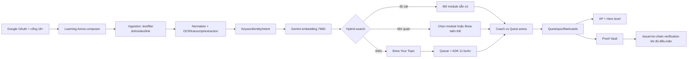

# Kiến trúc đích — GON.org AI Learning Arena

Tài liệu này ánh xạ prototype `apps/gon-web` sang hệ thống production lấy cảm hứng từ **WSIC** (search 768D + Brew) và **FastChat/Arena** (so sánh hai đáp án), nhưng sửa các điểm yếu đã biết thay vì sao chép nguyên trạng.

## 1. Luồng nghiệp vụ

## 2. Thành phần đề xuất

| Lớp | Lựa chọn tham chiếu WSIC | Ghi chú GON |
|---|---|---|
| Web | Next.js/React | Giữ Arena composer, stream trạng thái pipeline, không để API key ở client |
| Auth | Google OAuth/Better Auth | Kiểm tra session ở mọi API ghi; chính sách 18+ riêng với đăng nhập |
| DB/realtime | Convex | Project, source, module, interaction, proof, notification; index tách public/private |
| Auth DB (nếu giữ Better Auth như WSIC) | PostgreSQL | Chỉ dữ liệu auth; không nhân bản hồ sơ học tập |
| Queue | Upstash QStash hoặc tương đương | Chữ ký webhook, deadline, retry có idempotency key |
| Orchestrator | Flask/FastAPI trên Render/Cloud Run | Kiểm tra chủ đề trước pipeline đắt tiền |
| Agents | Google ADK trên Cloud Run | SequentialAgent, output schema, state tối thiểu |
| Models | Gemini 2.5 Flash cho nghiên cứu/quyết định; Flash Lite cho tác vụ schema hẹp* | *Chốt model theo quota/giá tại thời điểm triển khai; cấu hình hoá, không hard-code rải rác |
| Embeddings | `gemini-embedding-001`, 768D, `SEMANTIC_SIMILARITY` | Lưu model/version/dimension cùng vector để tái lập chỉ mục |
| Research | Exa/Serper hoặc nhà cung cấp đã duyệt | Lưu URL, thời điểm truy xuất, đoạn trích hỗ trợ từng claim |
| Storage | Object storage có signed URL | Quét malware, giới hạn MIME/dung lượng, chính sách giữ/xoá |

## 3. Search contract

Một truy vấn có thể chứa nhiều artifact. Văn bản chuẩn hoá dùng để tìm kiếm gồm: prompt người dùng + OCR/transcript/text trích xuất + metadata được phép, nhưng mỗi thành phần vẫn giữ provenance riêng.

- **Exact/full-text:** tiêu đề, alias, keyword.
- **Vector:** cosine trên vector 768D.
- **Specificity guard:** độ phủ thực thể/từ khóa đặc thù. Đây là bài học từ prototype: hai chủ đề cùng là “học tập” không được coi là trùng khớp chỉ vì embedding chung ngữ cảnh.
- **Phân loại:** `found` (mở ngay), `related` (hiển thị + cho Brew), `missing` (ưu tiên Brew). Ngưỡng production phải hiệu chuẩn bằng tập truy vấn gán nhãn; tài liệu WSIC dùng vùng điểm cao quanh 0.85 cho kết quả mạnh, không mang ngưỡng demo 0.58 lên production.

## 4. Brew: 11 bước và kiểm soát chất lượng

Kế thừa pipeline WSIC nhưng đặt **citation/grounding verification thành cổng bắt buộc**, vì nguồn WSIC hiện chưa tự kiểm chứng từng câu:

1. Research Brief — câu hỏi, phạm vi, nguồn ứng viên.
2. Quiz chẩn đoán.
3. Research Deep — nội dung có claim↔source mapping.
4. Reorder/process challenge.
5. Real-world Impact Quest.
6. Final Quiz/Boss.
7. Flashcards/summary.
8. Category, tags, description.
9. Thumbnail brief (không dùng ảnh không rõ quyền).
10. Assembler — hợp nhất theo schema + safety/provenance gate.
11. Writer — ghi một lần vào DB, phát sự kiện hoàn tất.

Trước pipeline: `topic-checker` chặn input rỗng/lặp/nguy hiểm. Lỗi xác định (invalid topic) không retry; lỗi tạm thời retry tối đa 3 lần. Mọi request có `generation_requests` gồm `idempotency_key`, `user_id`, hash đầu vào, trạng thái, số lần thử, chi phí và lỗi cuối; retry không được tạo module trùng.

## 5. Mô hình dữ liệu tối thiểu

- `users`, `hero_profiles`, `consents`
- `projects` (input gốc là dự án học, không chỉ là lịch sử chat)
- `source_artifacts` (loại, URL/file ref, hash, extraction status, quyền)
- `topics`, `modules`, `blocks` (union kiểu nội dung có schema)
- `embeddings` (vector 768, model, version, source span)
- `generation_requests` (idempotency + pipeline state)
- `interactions` (quest/quiz/flashcard/arena vote)
- `proofs` (issuer, bằng chứng, cấp xác minh, trạng thái thu hồi)
- `notifications`, `audit_events`

## 6. Proof of Learning không được “tự phong”

| Cấp | Nghĩa | Được hiển thị |
|---|---|---|
| 0 Self-declared | Người dùng tự khai | “Tự khai” |
| 1 Source-linked | Có file/link + hash, chưa đối chiếu chủ sở hữu/issuer | “Đã gắn nguồn” |
| 2 System-recorded | GON tự ghi quiz/quest/module | “GON ghi nhận trong hệ thống” |
| 3 Issuer-verified | Đối chiếu tổ chức/chữ ký/POAP wallet theo quy trình | “Issuer đã đối chiếu” |
| 4 Anchored | Neo POAP/SBT/sổ cái | “Đã neo” + vẫn link provenance off-chain |

Ảnh chứng chỉ, bài Facebook hoặc video YouTube **không tự động** là Issuer-verified. Public profile chỉ hiển thị dữ liệu người dùng đồng ý công khai; dữ liệu y tế/hiến máu nhạy cảm phải tách consent và không dùng để xếp hạng gây áp lực.

## 7. FastChat/Arena được chuyển hoá ra sao?

FastChat cho hai chatbot trả lời song song rồi vote. GON giữ UX so sánh nhưng đổi đối tượng: **AI Coach Path** (giải thích, roadmap, nhắc việc) đấu với **Quest/Game Path** (thử thách, XP, Boss Proof). Vote Left/Right/Tie/Both-bad của Arena trở thành chọn trái/chọn phải/hợp nhất/chưa hợp; tín hiệu này là learning-style preference, không dùng để khẳng định một model “đúng” hơn nếu chưa chấm bằng rubric.

## 8. Bảo mật, an toàn, pháp lý

- Mọi API queue/ghi dữ liệu xác thực session + chữ ký queue; rate-limit theo user/token budget.
- Không fetch URL nội bộ (SSRF), không tin MIME client khai, không thực thi file tải lên.
- Tôn trọng robots/bản quyền/điều khoản YouTube/Facebook; chỉ lưu metadata/transcript khi có quyền/phương thức hợp lệ.
- AI Coach về sức khỏe không chẩn đoán, kê đơn hay thay chuyên gia; nội dung hiến máu phải hướng về cơ quan y tế/điểm hiến chính thức.
- Không biến proof/XP thành cam kết tài chính. Nếu có token ở tương lai, cần tư vấn pháp lý độc lập và cảnh báo rủi ro tương tự ZOFO.
- Ghi audit cho thay đổi cấp proof; có quy trình sửa/thu hồi khi bằng chứng sai.

## 9. Lộ trình triển khai

1. **P0:** OAuth thật, project/source CRUD, upload an toàn, một embedding provider.
2. **P1:** hybrid search có tập đánh giá, module player, XP/proof system-recorded.
3. **P2:** Brew queue + ADK + grounding gate + thông báo realtime.
4. **P3:** OCR/transcript, POAP/issuer verification, GDevelop exporter đã kiểm thử.
5. **P4:** Guild/community sau khi có moderation, anti-cheat và chính sách dữ liệu nhạy cảm.
