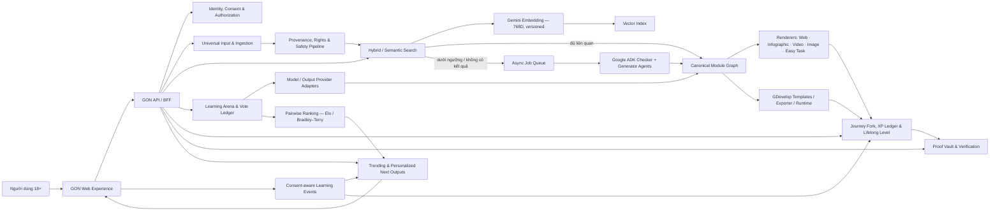

# Gate 0 — Source & Architecture Charter cho GON

> **Artifact:** G0-CHARTER<br>
> **Phiên bản:** 1.0<br>
> **Ngày:** 22/10/2026<br>
> **Trạng thái:** **IN REVIEW — chờ Product Owner duyệt gói Gate 0**<br>
> **Repository đích:** [`khanhlegood1/GDevelop`](https://github.com/khanhlegood1/GDevelop)<br>
> **Baseline khi Gate 0 bắt đầu:** `c1cd266e47117b37fe5158eddc0d51158b52561a`

## 1. Tóm tắt quyết định trong 60 giây

GON sẽ **không** được xây bằng cách ghép nguyên ba codebase. GON dùng ba nguồn theo đúng điểm mạnh đã Audit:

| Nguồn | Vai trò trong GON | Cách dùng tại Gate 0 |
|---|---|---|
| **FastChat** | Learning/Output Arena: hai output side-by-side, ẩn nhãn, vote left/right/tie/both-bad, regenerate/new round, conversation state, pairwise ranking concepts | Chủ yếu **reimplement pattern** trong frontend/API GON; chỉ cân nhắc port thuật toán rating hoặc đoạn code nhỏ sau khi có test độc lập |
| **WSIC** | Semantic Search bằng Gemini embedding 768D; Brew Your Topic; Google ADK topic checker/generator; queue/retry; realtime data patterns | **Port có chọn lọc hoặc reimplement có kiểm soát** cho schema/embedding/agent contracts; không mang nguyên auth/data-access/dependency state sang production |
| **GDevelop + GON hiện tại** | Nguồn sự thật của sản phẩm, brand, prototype, lifelong level, White Paper; hướng game renderer/templates/export từ learning module | **Repository production**; dùng GDevelop cho game runtime/export, không mặc định dùng làm web/backend framework |
| **ZOFO, Arena.ai, TikTok, Facebook** | Tham chiếu định vị, hành vi và trải nghiệm mong muốn | **Reference only**, không phải nguồn code |

### Hệ quả quan trọng

Các năng lực tạo khác biệt của GON **chưa có sẵn hoàn chỉnh** trong FastChat/WSIC và phải do GON tự thiết kế/xây:

- Universal Input đa phương thức kèm provenance, quyền sử dụng và kiểm duyệt.
- Canonical Module Graph dùng chung cho web, infographic, video, image, task và game.
- Journey Fork kiểu Git cho hành trình học cá nhân.
- Server-authoritative XP Ledger và Lifelong Numeric Level.
- Proof Vault/verification cho POAP, mạng xã hội, video, ảnh/chứng chỉ.
- Trending + personal footprint recommender có kiểm soát riêng tư.
- Creator attribution, success path và cơ chế chống thao túng.
- Assessment integrity để người học phải chứng minh hiểu thật.
- GDevelop exporter và telemetry hai chiều.
- Production security, observability, cost controls và operations.

## 2. Phạm vi và ngoài phạm vi của Gate 0

### 2.1 Gate 0 quyết định

- Nguồn chính cho từng nhóm tính năng.
- Chế độ reuse được phép: dependency, port, reimplement pattern, reference-only hoặc reject.
- Repository production và ranh giới component logic.
- Các thành phần GON phải sở hữu.
- Rủi ro/giả định có thể làm thay đổi kiến trúc.
- Quyết định nào phải để P01 hoặc P03.

### 2.2 Gate 0 chưa quyết định

- MVP scope cuối cùng và acceptance criteria chi tiết — **P01**.
- Màn hình/flow chính thức — **P02**.
- Frontend/backend framework, database/vector store, auth provider, queue và cloud vendor — **P03 bằng ADR riêng**.
- Gemini model cụ thể cho từng tác vụ ngoài contract embedding 768D đã được PO nêu — **P03/P04 qua evaluation**.
- Có phát hành token/tài sản chuyển nhượng hay không — hiện tại **không phát hành**; mọi thay đổi cần quyết định và rà soát pháp lý riêng.
- Production deployment — **P06 với Go-Live riêng**.

## 3. Nguồn đã Audit và mốc truy vết

Audit Gate 0 là Audit tĩnh có mục tiêu trên các snapshot dưới đây. Đây chưa phải chứng nhận bảo mật.

| Nguồn | Snapshot Audit | Giấy phép | Nhận định ngắn |
|---|---|---|---|
| FastChat — `khanhlegood1/FastChat` | `587d5cfa1609a43d192cedb8441cac3c17db105d` (02/06/2025), `fschat 0.2.36` | Apache-2.0 | Mạnh về Arena/vote/rating và provider patterns; Gradio monolith, logging/privacy và dependency không phù hợp để bê nguyên |
| WSIC — `khanhlegood1/wsic` | `2723e6d53edde3f282d80c4185b3a9d5192e8692` (14/10/2026) | MIT | Khớp trực tiếp với Search/Brew/ADK; cần thiết kế lại authorization, public mutations, cost-abuse controls và cập nhật dependencies trước production |
| GDevelop/GON — repo hiện tại | `c1cd266e47117b37fe5158eddc0d51158b52561a` tại thời điểm bắt đầu Gate 0 | Core/GDJS/newIDE/Extensions: MIT; tên/logo GDevelop có giới hạn thương hiệu riêng | Đúng hướng cho game/templates/export; prototype GON hiện tại là static demo, chưa phải backend production |

Chi tiết bằng chứng và cảnh báo nằm trong:

- [Thẻ Audit FastChat](audits/FASTCHAT-AUDIT.md)
- [Thẻ Audit WSIC](audits/WSIC-AUDIT.md)
- [Thẻ Audit GDevelop & GON hiện tại](audits/GDEVELOP-AND-CURRENT-GON-AUDIT.md)

## 4. Bản đồ nguồn theo tính năng

| Nhóm tính năng GON | Nguồn chính | Nguồn phụ | Reuse mode | GON phải sở hữu |
|---|---|---|---|---|
| Đăng nhập Google, xác nhận 18+ | WSIC auth pattern | GON policy | Reimplement trên provider được P03 duyệt | Age/consent policy, session, authorization, account recovery |
| Universal Input: text/file/image/URL/video | GON | WSIC search entry pattern | Build new | Parser/OCR/transcript pipeline, malware scan, rights/provenance |
| Semantic Search 768D | WSIC | Gemini API | Port có sửa hoặc reimplement theo contract P03 | Chunking, versioning, threshold calibration, hybrid ranking |
| Brew Your Topic | WSIC | Google ADK/Gemini | Port có sửa agent contracts/prompts sau eval | Job state, idempotency, quota/cost, moderation, provenance |
| Interactive learning blocks | WSIC block model | Prototype GON | Adapt thành Canonical Module Graph | Schema versioning, renderer contracts, accessibility |
| Arena hai output & vote | FastChat | GON UX | Reimplement state machine/UI | Authenticated vote policy, anti-abuse, output versioning |
| Xếp hạng output/model | FastChat Elo/Bradley–Terry concepts | GON analytics | Cân nhắc port thuật toán sau test; còn lại reimplement | Eligibility, confidence, anti-collusion, explainability |
| Multi-provider output generation | FastChat provider-dispatch pattern | WSIC ADK | Reimplement adapter interface | Model routing, safety settings, cost/quality policy |
| Trend & footprint next-output | GON | WSIC interaction counters; TikTok/Facebook behavior reference | Build new | Consent, feature store, ranking, exploration, fairness/abuse controls |
| Journey Fork | GON | Git metaphor | Build new | Branch/version model, merge/share permissions |
| Lifelong XP/Level | GON hiện tại | White Paper `gon-level-v1` | Evolve prototype thành server ledger tại P03/P04 | Anti-cheat, reversal/appeal, audit |
| Proof Vault | GON | POAP/social/certificate references | Build new | Verification levels, evidence hashing, privacy/retention |
| Game học tập | GDevelop | Canonical Module Graph | Integrate/export | Template mapping, telemetry, result verification |
| Realtime/job status | WSIC patterns | Tech được P03 chọn | Reimplement theo contract | Backpressure, retries, dead-letter, user notifications |
| Safety/assessment integrity | GON | FastChat/WSIC checks chỉ là gợi ý ban đầu | Build new | Moderation, plagiarism/copy detection, proctored/evidence rules theo mức độ |

Ma trận đầy đủ theo Requirement ID nằm tại [FEATURE-SOURCE-TRACEABILITY.md](FEATURE-SOURCE-TRACEABILITY.md).

## 5. Kiến trúc logic mục tiêu

Sơ đồ dưới đây là **logical architecture**. Nó cố định trách nhiệm và luồng dữ liệu, chưa cố định vendor triển khai.



### 5.1 Nguyên tắc trong sơ đồ

1. **Input là bằng chứng học tập, không chỉ là query.** Mọi input cần nguồn gốc, thời gian, quyền sử dụng, trạng thái xử lý và liên kết tới journey.
2. **Search không bao giờ kết thúc bằng “không có kết quả”.** Nếu không đủ liên quan, hệ thống đề xuất Brew hoặc làm rõ intent.
3. **Module được sinh một lần vào Canonical Module Graph.** Các renderer không tự phát minh schema riêng.
4. **Arena vote là sự kiện có chữ ký nghiệp vụ.** Vote phải gắn user/eligibility, output version, prompt/input version và chống trùng/thao túng.
5. **XP/Level là ledger phía server.** Client chỉ hiển thị; công thức đang khóa ở White Paper là `floor(LifetimeXP / 100)`, không có max level.
6. **Footprint không đồng nghĩa giám sát mặc định.** Thu thập phải có mục đích, consent, retention và khả năng tắt/xóa theo policy được P01/P03 duyệt.
7. **GDevelop nhận module đã chuẩn hóa.** Game không phải nơi lưu logic XP/proof gốc; game gửi telemetry đã ký/được xác thực về GON.

## 6. Component boundaries đề xuất

Đây là ranh giới **logic**; đường dẫn thư mục vật lý và package manager sẽ được chốt tại P03.

| Component logic | Trách nhiệm | Không được làm |
|---|---|---|
| `gon-web` | UX, trình bày module/arena/journey, client state không nhạy cảm | Tự quyết XP, vote hợp lệ, quyền truy cập hoặc proof đã xác thực |
| `gon-api` | BFF/API, authz, orchestration, rate limit, audit events | Chứa prompt/agent logic dài hạn không có contract riêng |
| `gon-contracts` | OpenAPI, JSON Schema, Canonical Module Graph, event schemas | Chứa business implementation |
| `gon-search` | Embedding, indexing, hybrid retrieval, threshold/Brew decision | Tự publish nội dung chưa qua policy |
| `gon-agents` | ADK checker/generator và tools tối thiểu | Giữ quyền ghi database không giới hạn hoặc tự phê duyệt nội dung |
| `gon-arena` | Pairing, vote ledger, pairwise rating | Dùng IP thuần túy làm danh tính vote production |
| `gon-journey` | Fork/version, XP ledger, level projection | Cho client cộng XP trực tiếp |
| `gon-proof` | Evidence intake, verification status, credential references | Tuyên bố chứng chỉ/POAP hợp lệ nếu chưa có verifier phù hợp |
| `gon-recommendation` | Trend/footprint ranking và giải thích gợi ý | Thu thập footprint ngoài consent/policy |
| `gon-gdevelop-bridge` | Module Graph → templates/project/runtime, telemetry intake | Sửa XP/proof gốc ngoài API đã xác thực |
| `gon-operations` | IaC, CI/CD, observability, runbooks | Chứa secrets trong repo |

## 7. Chính sách reuse bốn mức

| Mức | Ý nghĩa | Điều kiện |
|---|---|---|
| **Dependency** | Dùng thư viện/dịch vụ qua API/package chính thức | Pin version, SCA/SBOM, license check, update policy |
| **Port** | Sao chép và sửa một phần code upstream | Ghi URL/commit/license/NOTICE, diff được review, test mới, security scan |
| **Pattern reimplementation** | Học hành vi/kien trúc rồi viết code GON mới theo contract | Ghi nguồn cảm hứng trong audit/design; không sao chép biểu đạt không cần thiết |
| **Reference-only** | Chỉ tham chiếu sản phẩm/hành vi | Không dùng code, asset, trademark hoặc tuyên bố của bên thứ ba |
| **Reject** | Không dùng | Ghi lý do để tránh đề xuất lại vô căn cứ |

Mọi port trong P04 phải có một note tối thiểu:

```text
Upstream:
Commit:
License:
Files consulted/copied:
Modifications:
Tests added:
Security/privacy review:
Owner in GON:
```

## 8. Quyết định đã khóa tại Gate 0

| ID | Quyết định | ADR |
|---|---|---|
| D-G0-01 | Production code của GON ở `khanhlegood1/GDevelop` | [ADR-0001](adr/ADR-0001-PRODUCTION-CODE-IN-GDEVELOP-MONOREPO.md) |
| D-G0-02 | Reuse có chọn lọc sau Audit; không wholesale-fork FastChat/WSIC | [ADR-0002](adr/ADR-0002-SELECTIVE-OPEN-SOURCE-REUSE.md) |
| D-G0-03 | FastChat cho Arena; WSIC cho Search/Brew/ADK; GDevelop cho game/source of truth | [ADR-0003](adr/ADR-0003-SOURCE-TO-FEATURE-ALLOCATION.md) |
| D-G0-04 | Chưa khóa stack/vendor production tại Gate 0 | [ADR-0004](adr/ADR-0004-DEFER-PRODUCTION-STACK-LOCK-IN.md) |
| D-G0-05 | Lifelong Level giữ contract White Paper `gon-level-v1`: `floor(LifetimeXP / 100)`, unlimited | White Paper hiện hành |
| D-G0-06 | Chưa phát hành token; level tương lai nếu gắn token chỉ dựa trên lifetime-earned validated credits | White Paper hiện hành |

## 9. Quyết định mở

### 9.1 Phải trả lời tại P01

- Vertical slice đầu tiên và tiêu chí MVP.
- Mức xác minh 18+ cần thiết cho giai đoạn đầu.
- Journey/Fork mặc định private hay public?
- Người dùng sở hữu/được cấp quyền gì với input và output?
- Creator reward ở giai đoạn đầu là XP/reputation hay có giá trị ngoài nền tảng?
- Ngôn ngữ và thị trường ra mắt đầu tiên.
- Mức footprint nào được phép thu thập sau consent?

### 9.2 Phải trả lời tại P03 bằng ADR

- Frontend tiến hóa từ prototype tĩnh hay chuyển framework mới?
- Backend TypeScript, Python hay hybrid theo boundary?
- Database/vector: Convex, PostgreSQL + pgvector hay phương án khác?
- Auth provider và cách nối identity với dữ liệu học tập.
- Queue/job và nơi chạy Google ADK.
- Object storage cho file/media/proofs.
- Cách tích hợp GDevelop: sinh project, nhúng GDJS runtime, hay cả hai theo giai đoạn?
- Cloud target, ngân sách AI và giới hạn chi phí/user/topic.

## 10. Rủi ro kiến trúc chính

| Rủi ro | Tác động | Giảm thiểu đã ghi vào quy trình |
|---|---|---|
| Port WSIC nguyên trạng làm lộ public mutations/authorization yếu | Mất dữ liệu, publish/delete trái phép | Reimplement data access; P03 authz matrix; P05 security tests |
| Port FastChat nguyên trạng kéo theo Gradio/logging IP/raw text | Privacy và vận hành kém | Reimplement Arena trong GON web/API; minimised event logging |
| Brew/ADK bị lạm dụng gây chi phí AI tăng vọt | Mất ngân sách, DoS tài chính | Auth, quota, cache/dedupe, rate limit, budget alerts, queue controls |
| Nội dung AI sai hoặc vi phạm bản quyền nguồn | Mất niềm tin/pháp lý | Provenance, citations, moderation, review states, takedown process |
| Vote/trend bị bot hoặc hội nhóm thao túng | Ranking sai, creator path mất công bằng | Eligibility, rate limits, anomaly detection, confidence intervals, audit/reversal |
| Footprint cá nhân hóa quá mức | Privacy và filter bubble | Consent, purpose limitation, retention, explainability, exploration controls |
| GDevelop exporter phức tạp hơn dự kiến | Trễ game slice | P03 spike nhỏ; Canonical Module Graph độc lập renderer |
| Scope gồm search + social + game + proof + creator economy | Không ra được MVP | P01 MoSCoW và vertical slices; non-goals bắt buộc |
| Token bị hiểu là cam kết tài chính | Pháp lý/danh tiếng | Không phát hành tại baseline; chỉ XP/credits nội bộ cho tới quyết định riêng |

## 11. Tiêu chí PO duyệt Gate 0

PO duyệt gói này khi đồng ý rằng:

- [ ] FastChat được giao đúng phần Arena/voting/rating patterns.
- [ ] WSIC được giao đúng phần Search 768D/Brew/ADK/queue patterns.
- [ ] GDevelop là production monorepo và hướng game/export.
- [ ] Các phần GON-owned ở mục 1 và 6 là đầy đủ ở mức Gate 0.
- [ ] Không wholesale-fork upstream vào production.
- [ ] Stack production sẽ được quyết tại P03, không suy diễn từ prototype/WSIC.
- [ ] P01 chỉ bắt đầu sau khi Gate 0 được duyệt.

## 13. Hành động tiếp theo sau khi duyệt

1. Đánh dấu Gate 0 `APPROVED` và baseline theo PR/merge được PO chỉ định.
2. Mở P01 trên branch riêng.
3. Tạo PRD, personas, MoSCoW, BDD acceptance criteria, success/guardrail metrics và đề xuất vertical slice đầu tiên.
4. Không viết production code mới trong P01.
