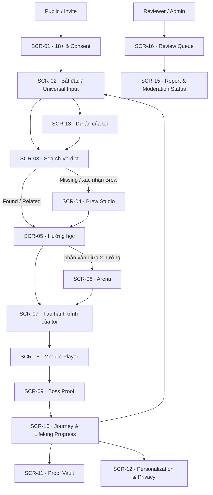

# P02 — Information Architecture

> 🔁 **Cập nhật PO — 24/10/2026 (tối muộn) — quyết định sản phẩm mới:** Persona đầu ra (🔬 PhD / Nghiên cứu · 🎬 KOL / Sáng tạo · 🎈 Giải trí · 🚀 Nâng cao) và các Độ sâu **không hiện ra cho user chọn** — mặc định **chạy tất cả các tổ hợp**, xuất nhiều output như feed TikTok. Output user chọn chính là Persona đầu ra của họ, đồng thời là tín hiệu **Arena** và **dấu chân đẳng cấp**. **Màn hình Brew và màn hình Arena đã được gộp vào chung màn hình Khám phá.** Nội dung dưới đây giữ nguyên làm tư liệu nền; chi tiết & trạng thái triển khai: [`PO-DECISION-UNIFIED-DISCOVER-2026-10-24.md`](../00-process/PO-DECISION-UNIFIED-DISCOVER-2026-10-24.md).

> **Trạng thái:** APPROVED tại P02 — Product Owner đã duyệt ngày 22/10/2026<br>
> **Mục tiêu:** Chốt cấu trúc tìm thấy, điều hướng và đặt tên đối tượng trước khi P03 định API/data contract.

## 1. Mô hình sản phẩm người dùng nhìn thấy

Người học không cần biết tên bảng dữ liệu hay pipeline AI. Hệ thống được giải thích bằng bảy đối tượng:

| Đối tượng UX | User hiểu là | Ví dụ hiển thị | Thuật ngữ kỹ thuật giữ ở hậu trường |
|---|---|---|---|
| **Input học tập** | Điều tôi đưa vào để bắt đầu | Câu hỏi, PDF, ảnh, link video/website | Source Artifact, Learning Project |
| **Kết quả tìm kiếm** | GON đã có gì và còn thiếu gì | Found / Related / Missing | Search verdict, semantic score |
| **Brew** | GON tạo một module nháp cho phần còn thiếu | “Brew Your Topic” | Generation job, ADK pipeline |
| **Hướng học** | Các cách tiếp cận khác nhau từ cùng một input | Game, deep dive, video quest, easy task | Output Candidate |
| **Hành trình của tôi** | Bản cá nhân tôi học và thay đổi | Nhánh riêng tư có tiến bộ riêng | Journey Fork/Branch |
| **Bằng chứng** | Thứ cho thấy tôi đã hiểu/làm được | Artifact, teach-back, link nguồn | Proof + verification level |
| **Tiến bộ suốt đời** | Tổng hành trình dài hạn của tôi | `Lv.12 · Hero · 1.280 XP` | Lifetime XP ledger |

Tên **Input học tập** và **Hướng học** được ưu tiên trong copy UI tiếng Việt. Các tên `Source Artifact`, `Output Candidate`, `Fork`, `Branch Commit` chỉ dùng trong tooltip kỹ thuật, tài liệu P03 hoặc ngữ cảnh creator nâng cao.

## 2. Sơ đồ IA



## 3. App shell

### 3.1 Header toàn cục

Header luôn có tối đa bốn nhóm:

1. **GON brand** — quay về `SCR-02`.
2. **Tìm trong GON** — tìm project, journey, module và proof thuộc quyền của user.
3. **Lifelong progress tóm tắt** — `Lv.N · Era`, Lifetime XP và progress tới level tiếp theo; click mở `SCR-10`.
4. **Thông báo + account** — job xong/lỗi, review result, profile và privacy.

Header không đặt nút tạo token, marketplace, public leaderboard hay KPI trend vì các mục này ngoài Private Alpha.

### 3.2 Điều hướng chính trên desktop

Rail trái dùng ngôn ngữ việc cần làm:

| Nhãn | Đích | Ghi chú |
|---|---|---|
| Bắt đầu | `SCR-02` | Tạo input mới hoặc tiếp tục project gần nhất |
| Dự án | `SCR-13` | Mọi input/project và trạng thái xử lý |
| Hành trình | `SCR-10` | Branch, mastery, level, next step |
| Proof Vault | `SCR-11` | Bằng chứng + mức xác minh |
| Cá nhân hóa | `SCR-12` | Footprint, ranking controls, export/delete request |

`Review Queue` chỉ xuất hiện nếu identity có role reviewer/admin. Không render menu operator cho learner rồi mới disable.

### 3.3 Điều hướng mobile

Bottom nav tối đa bốn mục:

| Bắt đầu | Hướng học / Học | Hành trình | Bạn |
|---|---|---|---|
| `SCR-02` | Màn hình task đang hoạt động gần nhất (`SCR-05` hoặc `SCR-08`) | `SCR-10` | `SCR-11`, `SCR-12`, `SCR-17` |

Nhãn mục thứ hai thay đổi theo project context để không buộc user mở menu khi đang học. Mọi đích còn lại nằm trong Project Stepper hoặc trang “Bạn”, không thêm hamburger chứa toàn bộ app.

### 3.4 Project Stepper theo ngữ cảnh

Khi user đang ở trong một project, một stepper cố định dưới header hoặc ở đầu nội dung hiển thị:

```text
1 Input → 2 Tìm/Brew → 3 Hướng học → 4 Hành trình → 5 Proof
```

Quy tắc:

- Có thể quay lại bước trước mà không mất dữ liệu đã nhập.
- Chỉ tiến lên bước sau khi điều kiện tiên quyết tồn tại.
- Mỗi bước có trạng thái bằng chữ: `Hoàn tất`, `Đang xử lý`, `Cần bạn quyết định`, `Bị chặn`, `Chưa bắt đầu`.
- Không dùng màu đơn độc để truyền đạt trạng thái.
- Stepper không biến thành progress “ép hoàn thành”; user có thể lưu và rời đi.

## 4. Route đề xuất cho P03 tham chiếu

Route slug chưa phải contract cuối cùng; **Screen ID mới là khóa truy vết ổn định**.

| Screen | Tên | Route đề xuất | Quyền |
|---|---|---|---|
| `SCR-01` | 18+ & Consent | `/welcome` | Invite / chưa đăng nhập |
| `SCR-02` | Bắt đầu / Universal Input | `/start` | Learner |
| `SCR-13` | Dự án của tôi | `/projects` | Owner |
| `SCR-03` | Search verdict | `/projects/{projectId}/search` | Owner |
| `SCR-04` | Brew Studio | `/projects/{projectId}/brew/{jobId?}` | Owner |
| `SCR-05` | Hướng học | `/projects/{projectId}/outputs` | Owner |
| `SCR-06` | Arena | `/projects/{projectId}/arena` | Owner |
| `SCR-07` | Journey Branch Home | `/journeys/{journeyId}` | Owner / được chia sẻ nội bộ |
| `SCR-08` | Module Player | `/journeys/{journeyId}/learn` | Owner |
| `SCR-09` | Boss Proof | `/journeys/{journeyId}/proof/{stepId}` | Owner |
| `SCR-10` | Journey & Lifelong Progress | `/progress` hoặc `/journeys/{id}` với summary toàn cục | Owner |
| `SCR-11` | Proof Vault | `/proof-vault` | Owner |
| `SCR-12` | Personalization & Privacy | `/you/personalization` | Owner |
| `SCR-14` | Notifications | `/notifications` | Owner |
| `SCR-15` | Report Status | `/reports/{reportId}` | Reporter / operator theo quyền |
| `SCR-16` | Review Queue | `/review` | Reviewer/Admin |
| `SCR-17` | Account Settings | `/you/account` | Owner |

Deep link phải khôi phục đúng trạng thái: ví dụ link tới Brew job đã xong không được quay về home; link tới module không còn quyền phải trả về permission state có thể hành động, không lộ metadata private.

## 5. Cấu trúc theo khu vực

### 5.1 Bắt đầu

- Universal Composer là thành phần chính.
- “Tiếp tục hành trình gần nhất” xuất hiện sau composer nếu có branch chưa xong.
- Project gần đây hiển thị trạng thái artifact/search/brew.
- Không có feed vô hạn ở đầu trang.

### 5.2 Dự án

Mỗi project card tóm tắt:

- tiêu đề do user sửa được;
- số Source Artifacts và artifact lỗi/partial;
- search verdict/Brew status;
- số hướng học, branch đang hoạt động;
- quyền riêng tư, lần cập nhật và next action duy nhất.

Hành động nguy hiểm như xóa project nằm trong overflow menu có xác nhận, không đặt cạnh CTA chính.

### 5.3 Hành trình

Một Journey Branch có ba lớp thông tin:

1. **Ngữ cảnh:** upstream module/version, attribution, privacy, ngày Fork.
2. **Việc học:** Module Player, Branch Commits, mở khóa theo mastery chứ không theo thời gian xem.
3. **Kết quả:** Boss Proof, mastery theo concept, gợi ý bước tiếp theo.

Không hiển thị commit hash dài cho learner phổ thông. Chỉ hiển thị nhãn thân thiện như “Bản nháp 3 · vừa lưu” và chi tiết kỹ thuật khi mở rộng.

### 5.4 Proof Vault

Proof được nhóm theo verification trước, sau đó mới theo ngày:

- `Issuer-verified` — ngoài Alpha hoặc khi có tích hợp/verify thật;
- `Source-linked` — đã gắn nguồn;
- `System-recorded` — GON ghi nhận theo event/rubric;
- `Self-declared` — user tự khai.

Tên bốn mức phải đi kèm một câu giải thích “mức này chứng minh điều gì và chưa chứng minh điều gì”. Không được rút gọn thành icon huy hiệu xanh duy nhất.

### 5.5 Vận hành

Khu vực reviewer tách khỏi learner IA:

- queue theo mức rủi ro và SLA;
- đúng module/output/proof version bị report;
- nguồn/citation/prompt lineage ở mức được phép;
- hành động approve/request changes/hide/escalate;
- audit note và trạng thái gửi lại cho reporter/creator.

Client không được quyết định role chỉ bằng việc ẩn/hiện menu; P03 phải định authorization ở server.

## 6. Tìm kiếm toàn cục và bộ lọc

Global search trong Alpha tìm trong:

- project/input của user;
- module catalog mà user được phép xem;
- journey/branch của user;
- proof metadata của user.

Không tìm footprint của người khác và không biến global search thành public social search.

Bộ lọc quan trọng:

- trạng thái: đang xử lý / cần quyết định / đang học / hoàn tất / lỗi;
- loại artifact: text/file/image/link/video;
- định dạng học: web/infographic/video/image/game/easy task/teach-back;
- verification level trong Proof Vault;
- thời lượng và độ khó trong Output Explorer.

## 7. Quy tắc đặt tên và nhãn

| Tránh | Dùng | Vì sao |
|---|---|---|
| Fork ngay | Tạo hành trình của tôi | Non-developer hiểu ngay hành động |
| Output Candidate | Hướng học | Nhấn lựa chọn học, không phải output máy |
| Không tìm thấy kết quả | Phần này chưa có trong kho tri thức | Mở đường tới Brew thay vì dead-end |
| Đã xác thực | Ghi rõ `System-recorded`/`Source-linked`/`Issuer-verified` | Ngăn phóng đại proof |
| AI System | Cách GON hoạt động | Điều hướng theo nhu cầu user |
| Winning output | Phù hợp hơn với mục tiêu hiện tại | Vote không phải chân lý phổ quát |
| Token balance | Lifetime XP | Alpha không phát hành token |
| Viral score | Tín hiệu quan tâm nội bộ | Không hứa lan truyền ngoài GON |

## 8. Trạng thái truy cập theo vai trò

| Khu vực | Learner | Creator* | Reviewer | Admin | Bị đình chỉ |
|---|---|---|---|---|---|
| Input/Search/Brew | Có, theo quota | Có | Chỉ tài khoản test được cấp | Có | Không tạo mới; vẫn xem lý do/appeal nếu policy cho phép |
| Journey/Proof của mình | Có | Có | Không mặc định | Theo audit policy | Read-only theo policy |
| Xuất bản nội bộ | Sau review | Gửi review | Duyệt | Duyệt/gỡ | Không |
| Proof người khác | Không trong Alpha | Không mặc định | Chỉ item được giao | Theo policy | Không |
| Review Queue | Không | Không | Có | Có | Không |
| Xóa footprint | Có | Có | Của chính mình | Của chính mình | Theo quyền dữ liệu áp dụng |

\* Creator không phải account type tách rời trong Alpha; đó là tập hành động của cùng một learner khi tạo/remix artifact.

## 9. Hệ quả cho P03

P03 phải cung cấp ít nhất các định danh/liên kết để UI không phải suy đoán:

- `projectId`, `artifactId`, `searchAttemptId`, `brewJobId`, `moduleVersionId`, `outputCandidateId`, `arenaMatchId`, `journeyId`, `branchCommitId`, `proofId`, `reportId`;
- visibility/ownership cho mọi deep link;
- trạng thái máy có thể map sang copy ở [Interaction States & Content](INTERACTION-STATES-AND-CONTENT.md);
- upstream/version/attribution cho Journey Branch;
- lý do ranking ở dạng nhóm tín hiệu có thể giải thích, không trả toàn bộ footprint thô cho client;
- phân tách rạch ròi `lifetimeXp`, `topicMastery`, `proofVerification`.

Nếu một màn hình phải tự suy ra quyền, trạng thái hoặc mức xác minh từ title/màu sắc, P03 chưa hoàn thành contract cho màn hình đó.
