# P02 — User Flows

> 🔁 **Cập nhật PO — 24/10/2026 (tối muộn) — quyết định sản phẩm mới:** Persona đầu ra (🔬 PhD / Nghiên cứu · 🎬 KOL / Sáng tạo · 🎈 Giải trí · 🚀 Nâng cao) và các Độ sâu **không hiện ra cho user chọn** — mặc định **chạy tất cả các tổ hợp**, xuất nhiều output như feed TikTok. Output user chọn chính là Persona đầu ra của họ, đồng thời là tín hiệu **Arena** và **dấu chân đẳng cấp**. **Màn hình Brew và màn hình Arena đã được gộp vào chung màn hình Khám phá.** Nội dung dưới đây giữ nguyên làm tư liệu nền; chi tiết & trạng thái triển khai: [`PO-DECISION-UNIFIED-DISCOVER-2026-10-24.md`](../00-process/PO-DECISION-UNIFIED-DISCOVER-2026-10-24.md).

> 🗄️ **Cập nhật PO — 24/10/2026 (23:36) — IndexedDB cho toàn bộ dự án:** toàn bộ dữ liệu phía client chuyển sang **IndexedDB** (localStorage chỉ còn fallback + nguồn migrate một lần); trang **Khám phá mang theo dữ liệu từ thanh tìm kiếm** (đồng bộ tất cả dữ liệu, hai chiều). Chi tiết: [`PO-DECISION-STORAGE-INDEXEDDB-2026-10-24.md`](../00-process/PO-DECISION-STORAGE-INDEXEDDB-2026-10-24.md) — code chính: `src/lib/browser-storage.ts`.

> **Trạng thái:** APPROVED tại P02 — Product Owner đã duyệt ngày 22/10/2026 
> **Cách đọc:** Mỗi flow có điểm vào, quyết định của user, phản hồi hệ thống, lối thoát/lỗi và tiêu chí hoàn thành. Tên trạng thái bám [Interaction States & Content](INTERACTION-STATES-AND-CONTENT.md).

## F01 — Lần đầu: 18+, đăng nhập và chọn cá nhân hóa

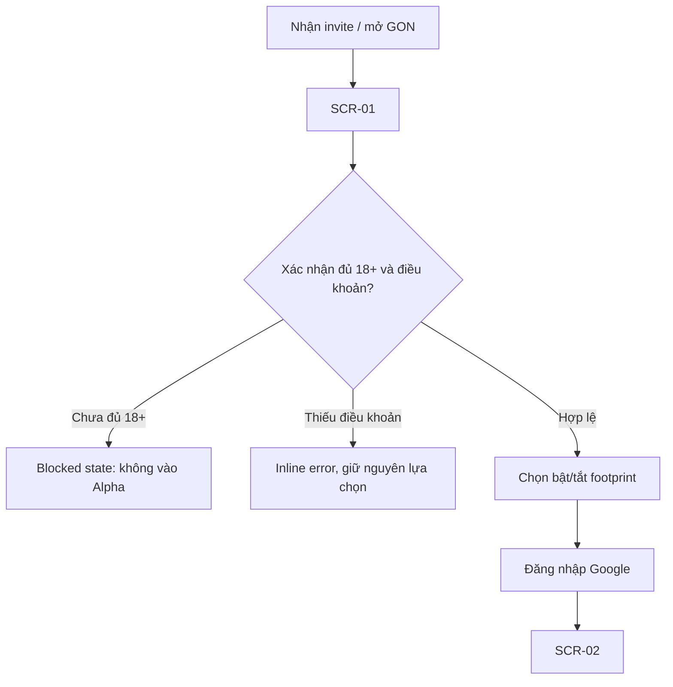

**Quy tắc:**

- Không yêu cầu upload giấy tờ.
- Lựa chọn cá nhân hóa có hai phương án cân bằng; nút từ chối không bị làm mờ như dark pattern.
- Nếu OAuth lỗi/hết phiên, quay lại đúng `SCR-01` kèm thông báo và giữ lựa chọn consent không nhạy cảm.
- Không tạo public profile ở onboarding.

**Hoàn thành khi:** user tới `SCR-02` và thấy trạng thái privacy mặc định của project tương lai.

**Prototype:** checkbox validation, lựa chọn “Tôi chưa đủ 18 tuổi”, mock Google CTA.

## F02 — Tạo input và nhận trạng thái artifact trung thực

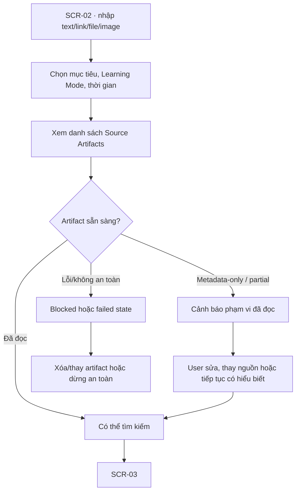

**Quy tắc:**

- Text gõ trực tiếp luôn là một Source Artifact, không biến mất khi thêm link/file.
- User có thể xóa từng artifact trước khi search; xóa trong lúc đang xử lý phải hủy hoặc đánh dấu không dùng kết quả của artifact đó.
- Hệ thống không nói “đã hiểu video/file” nếu chỉ có metadata.
- File/URL lỗi không làm mất phần text còn hợp lệ.

**Hoàn thành khi:** ít nhất một artifact hợp lệ được ghi nhận và Project Stepper chuyển sang bước Tìm/Brew.

## F03 — Search có kết quả: Found hoặc Related

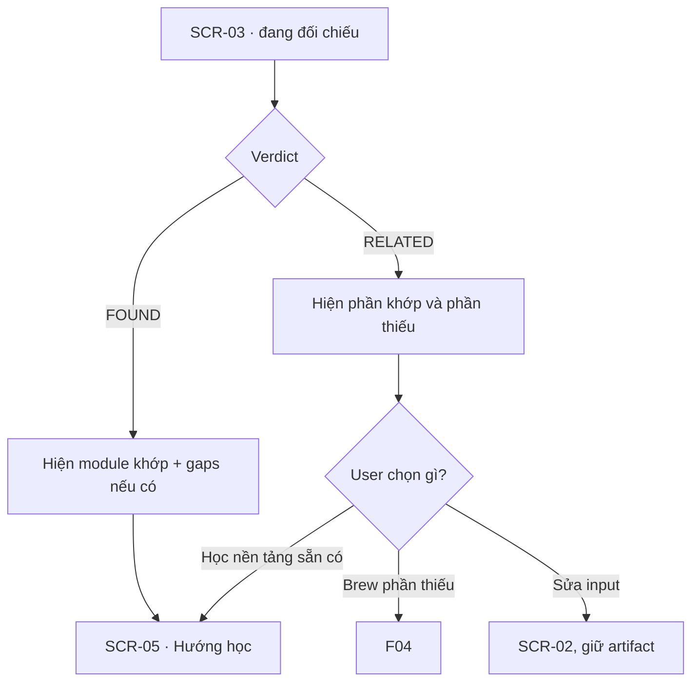

**Quy tắc:**

- `FOUND` vẫn hiển thị version, nguồn/citation status, định dạng, thời lượng và điều kiện tiên quyết.
- `RELATED` phải nói rõ “khớp X, thiếu Y”; không làm giả mức khớp bằng một phần trăm duy nhất.
- User luôn có thể quay lại sửa input.

**Hoàn thành khi:** user chọn một đường rõ ràng tới `SCR-05`, `SCR-04` hoặc quay về `SCR-02`.

## F04 — Missing/Clarify/Blocked và Brew có xác nhận

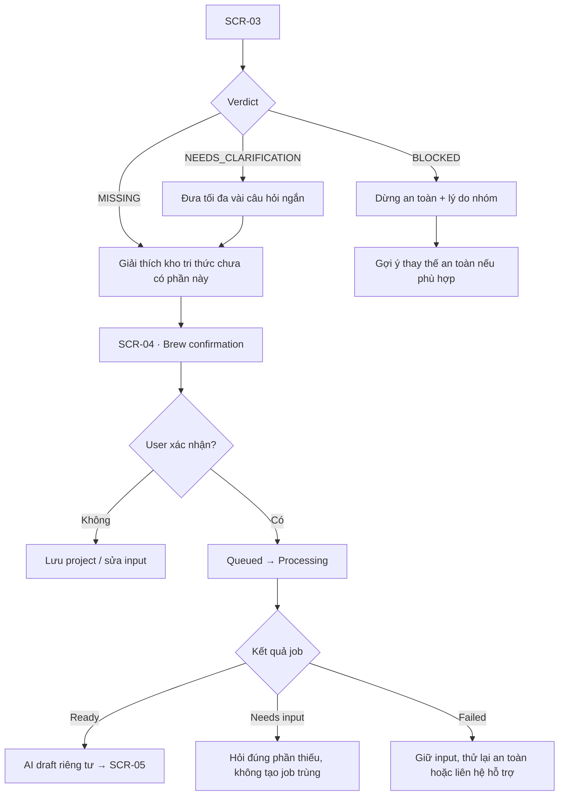

**Quy tắc:**

- Không tự chạy Brew khi user chưa xác nhận.
- Double-click/refresh không tạo cảm giác hai job; nút bị disable và trạng thái job được khôi phục khi quay lại.
- Progress dùng bước có chữ thay vì spinner vô hạn: kiểm tra chủ đề → nguồn/citation → module graph → quest/rubric → sẵn sàng.
- Ready không đồng nghĩa reviewed/public.

**Hoàn thành khi:** module draft sẵn sàng ở `SCR-05`, user chủ động dừng/sửa, hoặc có trạng thái failed/needs-input có đường tiếp theo.

## F05 — Khám phá 10+ Hướng học và kiểm soát ranking

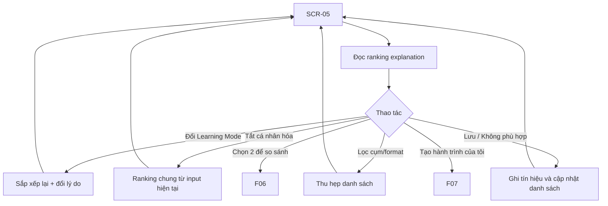

**Quy tắc:**

- Màn hình đầu tiên làm rõ tổng số hướng và có đường tới toàn bộ 10+ hướng; Top 3 nổi bật không được giấu phần còn lại.
- Card luôn có thời lượng, format, độ khó, artifact đầu ra, nguồn/citation state và “vì sao hiện ở đây”.
- “Không phù hợp” là tín hiệu preference, không phải report nội dung sai. Report là hành động riêng.
- Nếu chỉ còn ít hơn số hướng tối thiểu khả thi, hiển thị empty-recovery: bỏ lọc, hiện lại mục đã ẩn, sửa input hoặc Brew thêm.

**Hoàn thành khi:** user Fork, vào Arena hoặc lưu lại để quay lại sau.

## F06 — Blind Arena

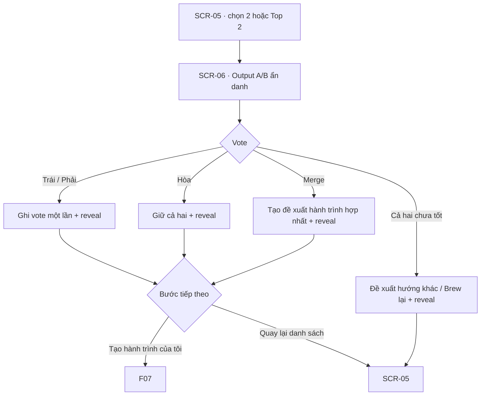

**Quy tắc:**

- Trước vote không lộ model/agent/creator/title gốc nếu title làm lộ danh tính; chỉ lộ đủ summary/format/artifact để đánh giá công bằng.
- Vote là thao tác một lần trong prototype. Production có thể cho sửa trong cửa sổ P03 định nghĩa, nhưng phải ngăn double-submit.
- Không có XP cho vote. Nếu có tín hiệu đóng góp trong tương lai, không tính vào Learning Level.
- Sau vote, giải thích ranking cá nhân thay đổi theo nhóm tín hiệu; không hiển thị công thức giả hoặc điểm “đúng”.

**Hoàn thành khi:** user biết kết quả vote ảnh hưởng gì và có CTA rõ tới Fork hoặc quay lại danh sách.

## F07 — Tạo hành trình riêng từ một hướng học

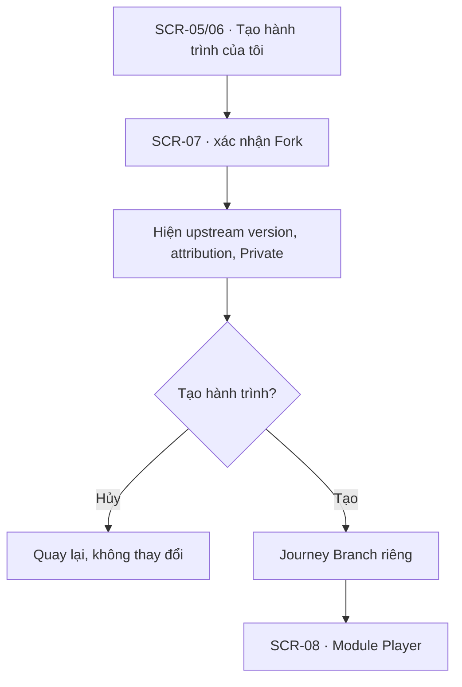

**Quy tắc:**

- Lần đầu cần giải thích một câu: bản gốc không đổi; thay đổi/progress nằm trong hành trình của user.
- Private là mặc định, không có checkbox “public” gây nhầm trong Alpha.
- Nếu user đã có branch từ cùng module version, hỏi tiếp tục branch cũ hay tạo branch mới thay vì lặng lẽ tạo trùng.

**Hoàn thành khi:** Branch Header chỉ rõ upstream, attribution, privacy và bước học hiện tại.

## F08 — Học thật: Concept → Retrieval → Transfer

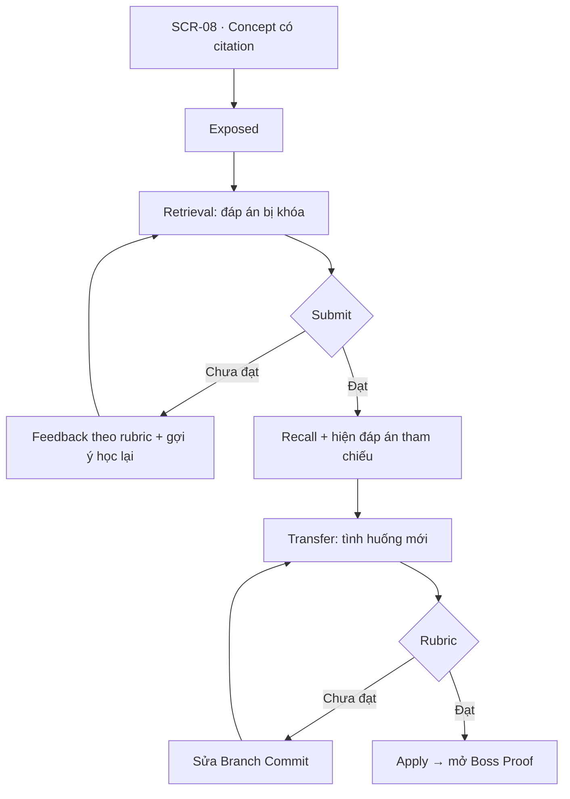

**Quy tắc:**

- Mỗi concept quan trọng liên kết tới citation hoặc nhãn unverified cần review.
- Paste dài không mặc nhiên bị kết tội gian lận; UX tập trung vào follow-up/rubric và khai báo nguồn/AI. Cơ chế integrity chi tiết thuộc P03/P05.
- User có thể lưu nháp và thoát. “Bỏ qua” trong prototype chỉ phục vụ review UX; production bỏ qua bước gating thì không mở khóa XP/Boss nếu P01 yêu cầu.
- Feedback phải nói phần nào đạt, phần nào thiếu và hành động sửa cụ thể.

**Hoàn thành khi:** Mastery tăng theo bằng chứng hành vi học và Boss Proof được mở đúng điều kiện.

## F09 — Boss Proof: nộp, sửa, đạt

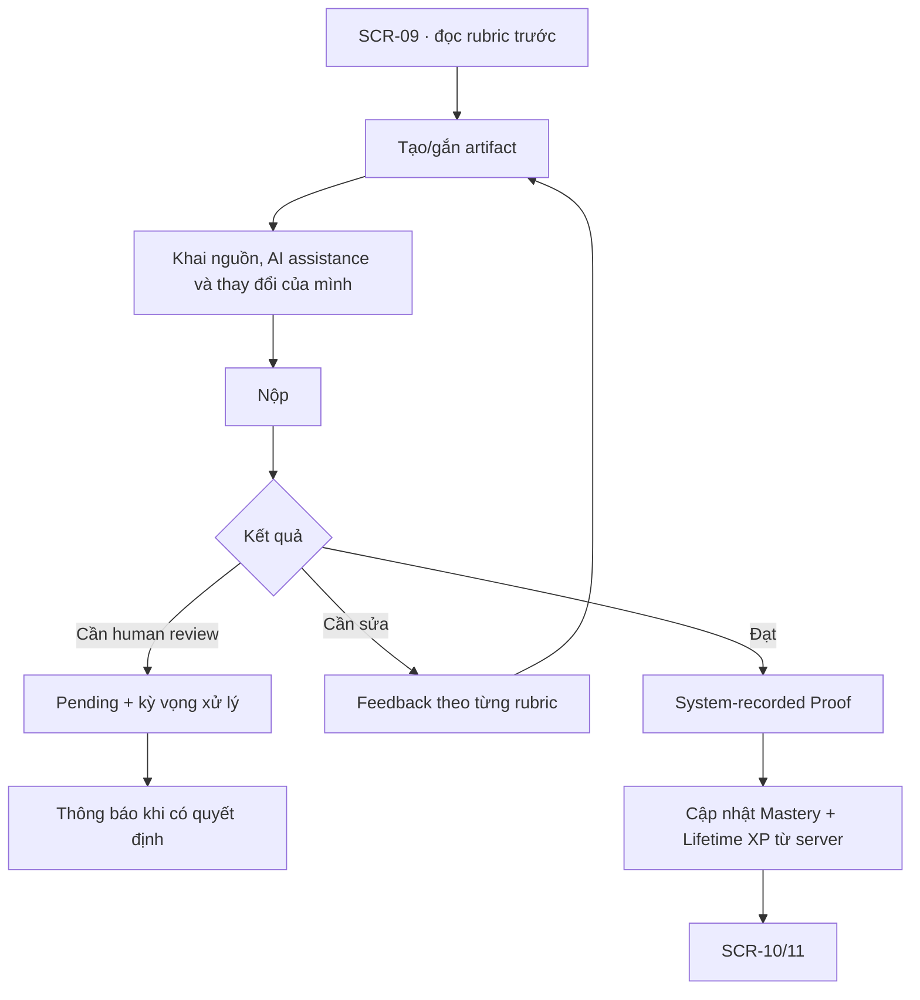

**Quy tắc:**

- Rubric xuất hiện trước khi làm, không chỉ ở màn hình kết quả.
- Artifact private vẫn có thể đạt System-recorded; user không bị ép công khai để có proof.
- Nếu kết quả cần sửa, giữ artifact/nháp và chỉ rõ field/rubric cần sửa.
- Màn hình thành công tách ba dòng: Proof level, Mastery mới, XP/Level mới.

**Hoàn thành khi:** Proof xuất hiện trong Vault với verification label và liên kết về Journey Branch.

## F10 — Gắn bằng chứng ngoài GON

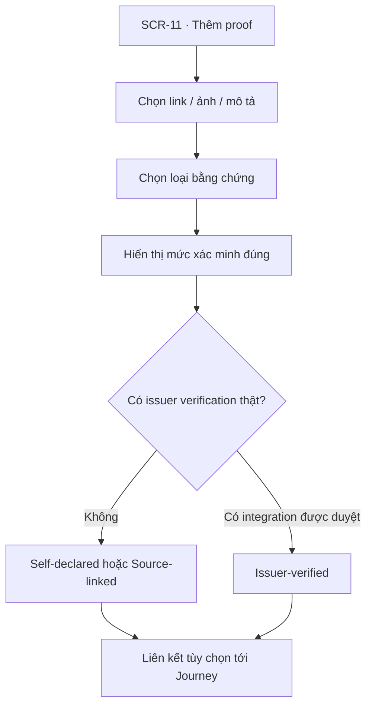

**Quy tắc:**

- Upload ảnh chứng chỉ không tự nâng mức xác minh.
- Link Facebook/YouTube/POAP chỉ chứng minh nguồn tồn tại ở mức Source-linked cho tới khi có quy trình đối chiếu được duyệt.
- Proof ngoài không tự cộng XP cốt lõi nếu không đi qua assessment/policy ở P03.

**Hoàn thành khi:** user hiểu điều proof chứng minh được và điều chưa chứng minh được.

## F11 — Tắt/xóa cá nhân hóa

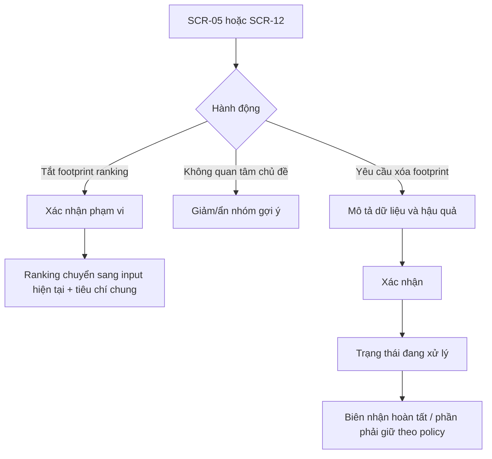

**Quy tắc:**

- Tắt cá nhân hóa không xóa project/journey/proof và không chặn học.
- Xóa footprint là luồng riêng, có xác nhận và biên nhận; không dùng toggle làm giả đã xóa.
- Sau khi tắt, ranking explanation thay đổi ngay trong UX contract.

**Hoàn thành khi:** user nhận trạng thái rõ ràng và quay lại học mà không bị “phạt”.

## F12 — Report và trạng thái kiểm duyệt

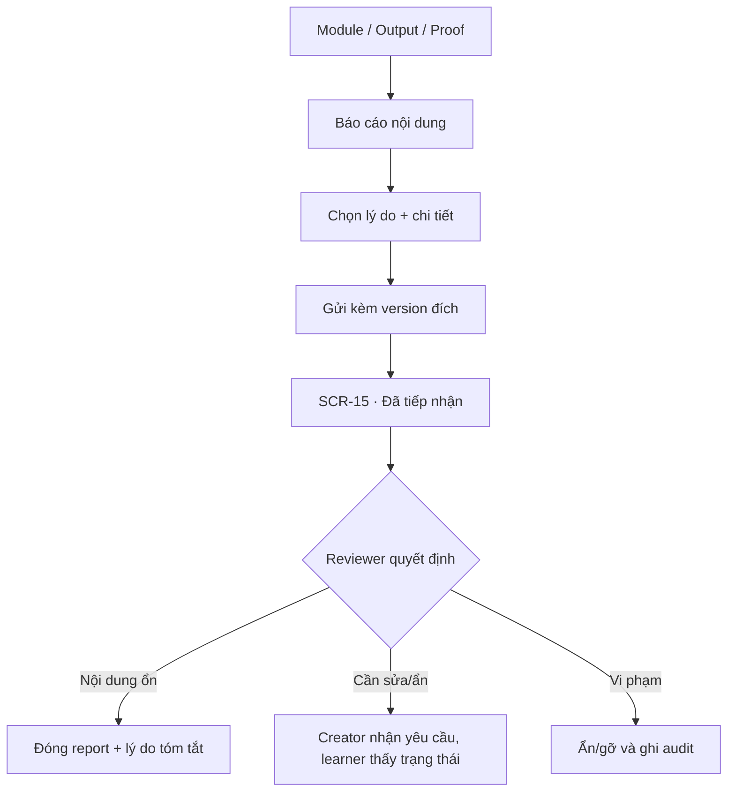

**Quy tắc:**

- Report không phải nút “Không phù hợp”. Hai hành động có nhãn, hệ quả và nơi đặt khác nhau.
- Reporter không thấy dữ liệu private của creator; creator không thấy danh tính reporter nếu policy bảo vệ danh tính.
- Nội dung đang bị review có banner trạng thái; user không bị mất branch/progress đã hợp lệ chỉ vì upstream bị ẩn, trừ quyết định policy ở P03/P05.

**Hoàn thành khi:** mọi phía biết version nào bị ảnh hưởng và bước tiếp theo.

## F13 — Reviewer xử lý AI draft/report

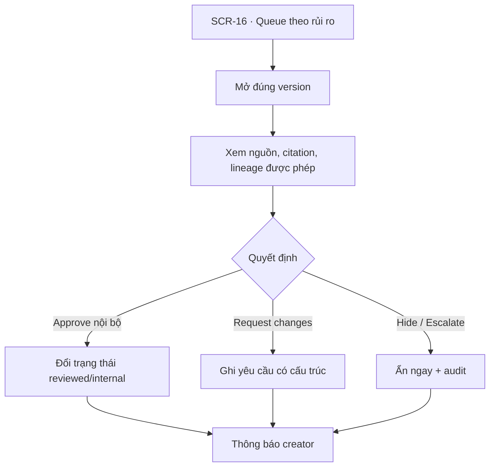

**Quy tắc:** reviewer không sửa trực tiếp branch/private proof của learner. Mọi quyết định có lý do và timestamp.

## F14 — Khôi phục phiên, lỗi mạng và quay lại sau

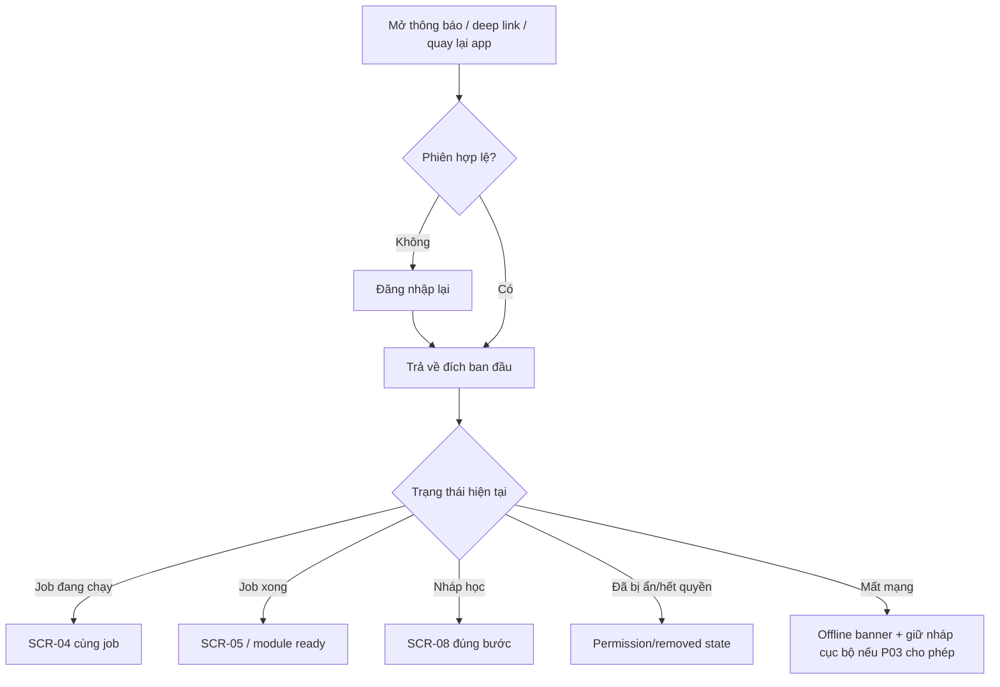

**Quy tắc:**

- Submit quan trọng phải có trạng thái `đang gửi`, `đã ghi nhận`, hoặc `không chắc chắn — kiểm tra lại`; user không bấm lặp vô hạn.
- Offline có thể cho đọc nội dung đã tải và soạn nháp, nhưng không hiển thị XP/Proof như đã được server xác nhận.
- Session-expired state giữ đích quay lại an toàn và không lộ dữ liệu private.

## Các flow chưa thuộc Private Alpha

P02 không thiết kế flow cho public profile, public leaderboard, theo dõi/follow, marketplace, mua bán token, rút tiền, quảng cáo footprint hay Success Path công khai. Nếu PO muốn đưa vào sau, đó là thay đổi P01/scope chứ không phải hệ quả tự nhiên của P02.
