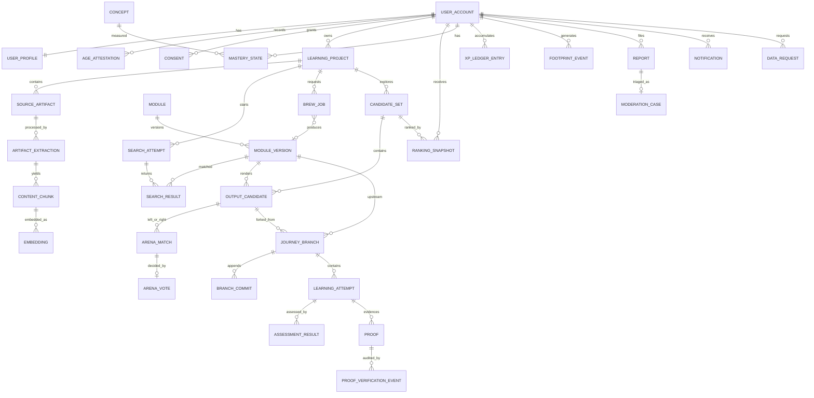

# P03 — Domain Model & ERD

> **Trạng thái:** IN REVIEW tại P03 
> **Mục tiêu:** Xác định dữ liệu nào tồn tại, thuộc về ai, thay đổi ra sao và bất biến nào database/API phải bảo vệ. Tên entity là contract logic; ORM ở P04 có thể map sang bảng vật lý snake_case.

## 1. Quy ước mô hình

### 1.1 Định danh và thời gian

- Mọi ID là chuỗi mờ, không đoán được, có tiền tố loại: `usr_`, `prj_`, `art_`, `srch_`, `job_`, `mod_`, `modv_`, `cset_`, `cand_`, `rank_`, `arena_`, `jrn_`, `att_`, `proof_`, `rpt_`, `evt_`, `game_`.
- ID không mã hóa owner, email, vai trò hay trạng thái. Quyền luôn kiểm tra ở server.
- Thời gian lưu UTC dạng timestamp; API trả ISO 8601/RFC 3339.
- Entity có thể sửa có `version` nguyên tăng dần để optimistic concurrency.
- Entity bất biến không có update API; thay đổi tạo version/event mới.

### 1.2 Owner, visibility và xóa mềm

- Mọi dữ liệu người dùng có `ownerUserId` hoặc truy được về owner qua aggregate cha không mơ hồ.
- `visibility` chuẩn: `private`, `internal_reviewed`, `unlisted_future`, `public_future`. Private Alpha chỉ dùng hai giá trị đầu cho nội dung học; hai giá trị cuối bị API từ chối cho tới phase được duyệt.
- Xóa ở API thường là tombstone (`deletedAt`) cho tới khi retention workflow xóa vật lý object/derived data. User không còn truy cập được ngay khi tombstone hiệu lực.
- Search chỉ tìm trên dữ liệu mà actor có quyền xem; authorization filter áp dụng **trước** ranking/limit.

### 1.3 JSONB được dùng ở đâu?

JSONB chỉ dùng cho snapshot có schema phiên bản rõ:

- `ModuleVersion.graph`
- rubric snapshot trong assessment
- signal breakdown trong RankingSnapshot
- provenance metadata có kiểm soát
- job input/output summary đã lược bỏ dữ liệu nhạy cảm
- game configuration từ template

Quan hệ, owner, trạng thái, số XP, vote và khóa ngoại không được giấu trong JSONB không có constraint.

## 2. ERD tổng quan

Sơ đồ không vẽ mọi bảng vận hành như outbox, audit log, quota và feature flags để giữ đường sản phẩm dễ đọc; chúng được đặc tả ở mục 8–10.

## 3. Identity, consent và hồ sơ

| Entity | Trường cốt lõi | Khóa/bất biến |
|---|---|---|
| `UserAccount` | `id`, `status`, `locale`, `timeZone`, `createdAt`, `deletedAt` | Domain ID không đổi khi đổi email/provider |
| `IdentityLink` | `userId`, `provider=google`, `providerSubject`, `emailAtLink`, `linkedAt` | Unique `(provider, providerSubject)`; không dùng email làm khóa chính |
| `UserProfile` | `userId`, `displayName`, `avatarObjectKey?`, `selfDeclaredHeadline?`, `version` | Học hàm/nghề tự khai không nằm trong proof/verified fields |
| `Invite` | `codeHash`, `status`, `expiresAt`, `redeemedByUserId?` | Chỉ lưu hash của code; redeem một lần |
| `AgeAttestation` | `userId`, `method=self_attested_18_plus`, `termsVersion`, `privacyVersion`, `attestedAt`, `evidenceHash?` | Append-only; không field nào được ghi “identity verified” |
| `Consent` | `userId`, `purpose`, `status`, `policyVersion`, `changedAt`, `source` | Unique hiện hành theo `(userId,purpose)`; lịch sử ở audit/event |
| `RoleGrant` | `userId`, `role`, `scope`, `grantedBy`, `expiresAt?`, `revokedAt?` | Reviewer/admin không suy ra từ email domain |

`status` của tài khoản: `invited`, `onboarding`, `active`, `suspended`, `deletion_pending`, `deleted`. User bị đình chỉ vẫn có thể thực hiện quyền dữ liệu theo policy nhưng không tạo nội dung mới.

## 4. Learning Project và Source Artifacts

### 4.1 `LearningProject`

| Nhóm | Trường |
|---|---|
| Sở hữu | `id`, `ownerUserId`, `visibility=private` |
| Nội dung | `title`, `goal`, `rawPromptArtifactId` |
| Ngữ cảnh phiên | `learningMode`, `depth`, `timeBudgetMinutes`, `locale` |
| Trạng thái | `status`, `currentSearchAttemptId?`, `currentBrewJobId?`, `currentCandidateSetId?` |
| Đồng thời | `version`, `createdAt`, `updatedAt`, `archivedAt?`, `deletedAt?` |

`LearningMode`: `deep_mastery`, `apply_at_work`, `create_publish`, `fast_entertaining`, `prove_impact`.

Project `status` là projection phục vụ danh sách/stepper; trạng thái chi tiết nằm ở artifact/search/job. API Workspace tính `nextAction` từ các trạng thái con thay vì để client tự suy luận.

### 4.2 `SourceArtifact`

| Nhóm | Trường |
|---|---|
| Quan hệ | `id`, `projectId`, `ownerUserId` |
| Nguồn | `kind`, `originUri?`, `displayName`, `sourcePlatform?`, `capturedAt` |
| File | `storageObjectKey?`, `declaredMimeType?`, `detectedMimeType?`, `byteSize?`, `sha256` |
| Quyền | `rightsBasis`, `rightsNote?`, `visibility=private` |
| An toàn/xử lý | `safetyStatus`, `extractionStatus`, `failureCode?` |
| Vòng đời | `createdAt`, `deletedAt?`, `version` |

`kind`: `text`, `website_url`, `youtube_url`, `facebook_url`, `file`, `image`, `audio_future`, `video_file_future`.

`rightsBasis`: `created_by_user`, `licensed_to_user`, `publicly_available_link`, `permission_claimed`, `unknown`. Giá trị này là khai báo của user, không phải xác minh pháp lý.

### 4.3 `ArtifactExtraction` và `ContentChunk`

Một artifact có thể được trích xuất lại khi pipeline/model thay đổi; mỗi lần là một extraction version.

`ArtifactExtraction` gồm:

- `artifactId`, `pipelineVersion`, `status`;
- coverage: `hasText`, `hasMetadata`, `hasTranscript`, `hasOcr`, `coverageRatio?`;
- `extractedTextObjectKey?` nếu văn bản lớn;
- `language?`, `pageCount?`, `durationSeconds?`;
- `errorCode?`, `startedAt`, `completedAt?`.

`ContentChunk` gồm `ownerUserId`, `sourceType`, `sourceId`, `ordinal`, `text`, `locator`, `language`, `tokenCount`, `contentSha256`. Chunk của artifact private chỉ được search trong phạm vi project/owner của nó; chunk của module tuân theo visibility của ModuleVersion.

`Embedding` gồm `chunkId`, `embeddingProfile`, `providerModel`, `modelVersion`, `taskType`, `dimensions=768`, `vector`, `normalized=true`, `indexVersion`. Vector là dữ liệu nội bộ và không có API public trả raw vector.

## 5. Search, Brew và Module

### 5.1 `SearchAttempt`

- Thuộc một project và snapshot các artifact/extraction versions được dùng.
- Lưu `contextSnapshot` gồm mode/goal/depth/time/locale và consent ranking có hiệu lực.
- `status`: `queued`, `running`, `completed`, `failed`, `cancelled`.
- `verdict`: `found`, `related`, `missing`, `needs_clarification`, `blocked_by_policy`.
- `matchedConcepts[]`, `missingConcepts[]`, `clarificationQuestions[]`, `policyReasonCodes[]`.
- `searchPolicyVersion`, `embeddingProfile`, `latencyMs`, `createdAt/completedAt`.

`SearchResult` trỏ tới `moduleVersionId`, có `rank`, điểm nội bộ đã tách lexical/vector/concept/quality, `matchedConcepts`, `missingConcepts`, `reasonCodes`. Điểm số nội bộ không phải bằng chứng đúng sai để hiển thị như phần trăm chất lượng tuyệt đối.

### 5.2 `BrewJob`

`BrewJob` là một `AsyncJob` chuyên biệt:

- `projectId`, `searchAttemptId`, `requestedByUserId`;
- `idempotencyKey`, `inputFingerprint` từ artifact versions + context + graph schema version;
- `status`, `currentStep`, `attemptCount`, `maxAttempts`;
- `quotaReservationId`, `estimatedCostUnits`, `actualCostUnits`;
- `resultModuleVersionId?`, `failureCode?`, `retryable`;
- `createdAt`, `startedAt`, `completedAt`, `cancelledAt`.

Unique nghiệp vụ: một owner + `idempotencyKey` chỉ tạo một job; một logical fingerprint đang active không tạo job song song thứ hai.

### 5.3 `Module` và `ModuleVersion`

`Module` là identity ổn định: `id`, `ownerUserId?`, `creatorType` (`user`, `ai_assisted`, `system_seed`), `attributionSnapshot`, `createdAt`.

`ModuleVersion` bất biến:

- `moduleId`, `versionNumber`, `graphSchemaVersion`, `graph` JSONB;
- `language`, `title`, `summary`, `estimatedMinutes`, `difficulty`;
- `visibility`, `publicationStatus`: `draft_private`, `pending_review`, `internal_reviewed`, `hidden`, `retired`;
- `groundingStatus`: `unverified`, `partially_cited`, `citation_checked`;
- `generationLineage`: BrewJob/agent/model/prompt template versions khi có;
- `sourceArtifactVersions[]`, `parentModuleVersionId?`, `contentSha256`;
- `createdByUserId?`, `createdAt`.

Module đã có branch trỏ vào không bao giờ bị sửa tại chỗ. Gỡ nội dung thay đổi `publicationStatus`/access policy và ghi moderation event; branch/proof lịch sử được xử lý theo policy ở State Machines.

### 5.4 Concept và citation

`Concept`: `id`, `slug`, `canonicalName`, `aliases[]`, `parentConceptId?`, `status`.

`ModuleConcept`: `moduleVersionId`, `conceptId`, `role` (`core`, `supporting`, `prerequisite`), `weight`.

Citation nằm trong graph snapshot để version tự chứa; bảng quan hệ `CitationReference` được tạo dạng projection để audit/report theo nguồn: `moduleVersionId`, `nodeId`, `claimId`, `sourceArtifactId?`, `externalSourceId?`, `locator`, `supportStatus`.

## 6. Candidates, Ranking và Arena

### 6.1 `CandidateSet`

- `projectId`, `searchAttemptId`, `sourceModuleVersionId?`;
- `generationMethod`: `existing_modules`, `graph_derived`, `template`, `mixed`;
- `generatorVersion`, `status`, `targetCount=10`, `actualCount`, `shortfallReasonCodes[]`;
- `diversitySummary`, `createdAt`, `expiresAt?`.

### 6.2 `OutputCandidate`

Candidate là một hướng học bất biến trong set:

- `candidateSetId`, `moduleVersionId`, `derivedFromCandidateIds[]`;
- `title`, `promise`, `cluster`, `format`, `artifactOutcome`;
- `estimatedMinutes`, `difficulty`, `prerequisiteConceptIds[]`, `conceptIds[]`;
- `sourceStatus`, `semanticFingerprint`, `qualityFeatures` nội bộ;
- `attributionSnapshot`, `status`: `eligible`, `hidden_by_policy`, `retired`.

`format`: `web_lesson`, `infographic`, `video`, `image_sequence`, `game`, `easy_task`, `teach_back`, `workshop_case`, `research_pack`.

Merge tạo candidate mới với lineage tới hai candidate gốc; không sửa candidate cũ.

### 6.3 `RankingSnapshot`

- `userId`, `projectId`, `candidateSetId`, `learningMode`;
- `algorithmVersion`, `personalizationApplied`, `consentVersionAtRanking`;
- `orderedCandidateIds[]`;
- `signalBreakdown` theo candidate: relevance, concept coverage, source quality, mode fit, time fit, personal fit, internal learning trend, diversity adjustment;
- `explanationCodes[]`, `createdAt`, `staleAt`.

Client nhận explanation codes và thứ hạng; trọng số/footprint thô không phải public contract.

### 6.4 Arena

`ArenaMatch`:

- `projectId`, `rankingSnapshotId`, `requestedByUserId`;
- `leftCandidateId`, `rightCandidateId` chỉ dùng phía server;
- `blindSeedHash`, `status`: `open`, `voted`, `expired`, `cancelled`, `invalidated`;
- `expiresAt`, `createdAt`.

`ArenaVote`:

- unique `(arenaMatchId, voterUserId)`;
- `choice`: `left_better`, `right_better`, `tie`, `both_bad`, `merge`;
- snapshot của candidate versions/context/mode;
- `idempotencyKey`, `createdAt`, `validity`: `valid`, `invalidated`;
- `resultingCandidateId?` nếu merge tạo candidate mới.

Vote không chứa IP làm identity. Tín hiệu chống lạm dụng lưu tối thiểu ở security event riêng theo policy, không trộn vào public vote record.

## 7. Journey, học tập, XP và Proof

### 7.1 `JourneyBranch`

- `ownerUserId`, `projectId`, `sourceCandidateId`, `upstreamModuleVersionId`;
- `parentJourneyId?`, `title`, `goal`, `visibility=private`;
- `attributionSnapshot`, `status`: `active`, `completed`, `archived`, `deleted`;
- `headCommitId?`, `currentNodeId?`, `version`, timestamps.

Upstream ra version mới không tự đổi `upstreamModuleVersionId`. Cập nhật là thao tác riêng ở VS3.

### 7.2 `BranchCommit`

Append-only:

- `journeyId`, `parentCommitId?`, `sequence`;
- `type`: `fork_created`, `attempt_passed`, `artifact_created`, `reflection`, `boss_submitted`, `proof_recorded`, `system_note`;
- `actorUserId`, `payloadRef`, `summary`, `createdAt`.

Click xem nội dung thường không thành commit.

### 7.3 `LearningAttempt` và `AssessmentResult`

`LearningAttempt`:

- `journeyId`, `moduleVersionId`, `nodeId`, `attemptNumber`;
- `status`: `draft`, `submitted`, `assessing`, `passed`, `needs_revision`, `pending_human_review`, `rejected`;
- `answerText?`, `artifactIds[]`, `sourceDisclosure`, `aiAssistanceDisclosure`;
- `rubricId`, `rubricVersion`, `version`, timestamps.

`AssessmentResult` bất biến theo lần chấm: criterion outcomes, feedback, `assessorType`, `assessorVersion`, `confidence`, integrity signals và quyết định. Chấm lại tạo result mới và audit lý do.

`MasteryState` unique `(userId, conceptId)`: `level`, `evidenceAttemptId`, `achievedAt`, `lastEvidenceAt`, `reviewDueAt?`, `version`.

### 7.4 XP Ledger

`XpLedgerEntry` append-only:

- `userId`, `delta` nguyên khác 0;
- `sourceEventId` unique cho entry posted;
- `sourceType`, `sourceId`, `ruleVersion`, `formulaVersion=gon-level-v1`;
- `status`: `posted`, `reversed`, `reversal`;
- `reversesEntryId?`, `reasonCode?`, `actorType`, `createdAt`;
- `lifetimeXpAfter` là snapshot kiểm chứng trong transaction, nhưng tổng ledger vẫn là nguồn tái lập.

`XpProjection`: `userId`, `lifetimeXp`, `lastEntrySequence`, `updatedAt`. NumericLevel/Era được tính từ Lifetime XP tại read model; không lưu một `maxLevel`.

### 7.5 Proof

`Proof`:

- `ownerUserId`, `proofType`, `title`, `description?`;
- `journeyId?`, `attemptId?`, `artifactIds[]`;
- `issuerDisplayName?`, `externalReference?`;
- `verificationLevel`: `self_declared`, `source_linked`, `system_recorded`, `issuer_verified`, `anchored`;
- `status`: `active`, `pending_verification`, `revoked`, `superseded`, `deleted`;
- `visibility=private`, timestamps, `version`.

`ProofVerificationEvent` append-only ghi from/to level, verifier, evidence refs, decision và reason. Contract không cho client tự đặt `issuer_verified`/`anchored`.

## 8. Footprint, trend và creator attribution

`FootprintEvent`:

- `userId`, `category`, `entityType`, `entityId`, `occurredAt`;
- `consentPurpose`, `consentStatusAtEvent`;
- thuộc tính tối thiểu như mode/cluster/format/mastery outcome; không sao chép raw answer/proof content.

Category Alpha: `goal_selected`, `candidate_saved`, `candidate_hidden`, `arena_voted`, `journey_started`, `attempt_passed`, `artifact_created`, `proof_recorded`, `not_interested`.

`PersonalizationPreference`: topic/format yêu thích, topic không quan tâm, controls do user chỉnh.

`TrendSnapshot` (VS5): window, candidate/module version, unique learners, completions, forks with artifact, proofs, report rate, algorithm version. Không dùng view/like đơn độc làm trend chính.

Attribution được snapshot trong ModuleVersion/JourneyBranch và có `AttributionEdge` để truy downstream ở VS5: source entity → derived entity, relation `created`, `remixed`, `forked`, `merged_from`, `source_for`.

## 9. Moderation, thông báo và quyền dữ liệu

- `Report`: reporter, target type/id, target version, reason code, detail đã giới hạn, status.
- `ModerationCase`: risk level, assignee, SLA due, status.
- `ModerationAction`: action, actor, structured reason, before/after status, createdAt.
- `Notification`: user, type, entity ref, title/body template keys, readAt; không chứa nội dung private nhạy cảm ngoài mức cần hiển thị.
- `DataRequest`: user, type `export`, `delete_footprint`, `delete_account`, scope, status, requestedAt/completedAt, receipt.

## 10. Vận hành, job và audit

- `AsyncJob`: type, aggregate ref, idempotency key, input fingerprint, status/step, attempts, lease, error.
- `OutboxEvent`: aggregate, event type/version, payload tối thiểu, publish state.
- `AiRun`: job, provider/model/prompt version, token/cost units, latency, finish reason; không lưu raw prompt chứa dữ liệu private theo mặc định.
- `QuotaReservation/Usage`: user, quota key, window, reserved/consumed/refunded.
- `FeatureFlag`: key, enabled, scope, version; kill switches tối thiểu `brew_enabled`, `internal_publish_enabled`, `trend_enabled`, `game_events_enabled`.
- `AuditLog`: actor type/id, action, object, request id, reason, before/after hash, createdAt. Audit không phải nơi sao chép toàn bộ nội dung user.

## 11. Chỉ mục và ràng buộc quan trọng

| Khu vực | Index/constraint bắt buộc |
|---|---|
| Identity | Unique provider subject; index account status |
| Projects | `(ownerUserId, updatedAt desc)`; status partial index |
| Artifacts | `(projectId, createdAt)`; `(ownerUserId, sha256)` để dedupe an toàn trong phạm vi owner |
| Chunks/Embeddings | `(sourceType, sourceId, ordinal)`; vector HNSW/IVFFlat theo profile; authorization fields để filter trước limit |
| Search | `(projectId, createdAt desc)`; results `(searchAttemptId, rank)` |
| Jobs | Unique `(ownerUserId, idempotencyKey)`; partial unique cho active fingerprint; `(status, availableAt)` |
| Modules | Unique `(moduleId, versionNumber)`; content hash index |
| Candidates | `(candidateSetId, semanticFingerprint)`; cluster/format filters |
| Arena | Unique vote `(matchId, voterUserId)` |
| Journeys | `(ownerUserId, status, updatedAt desc)`; upstream lookup |
| Attempts | `(journeyId, nodeId, attemptNumber)` unique |
| Mastery | Unique `(userId, conceptId)` |
| XP | Unique posted `sourceEventId`; `(userId, createdAt, sequence)` |
| Proofs | `(ownerUserId, verificationLevel, createdAt desc)` |
| Reports | `(status, riskLevel, createdAt)`; target index |
| Outbox | `(publishState, availableAt)` |

P04 phải chứng minh bằng migration/test rằng query private không thể lọt qua index/filter; chỉ có index không thay thế authorization test.

## 12. Tính bất biến theo aggregate

- Tạo project + initial text artifact là một transaction.
- Hoàn tất upload chỉ chuyển artifact sang queued khi hash/size/MIME khớp khai báo ở mức policy.
- SearchAttempt hoàn tất và SearchResults được ghi nguyên tử.
- BrewJob success chỉ công bố `resultModuleVersionId` sau khi ModuleVersion validate/citation gate xong.
- Vote + match status + outbox event là một transaction.
- Attempt passed + mastery update + XP entry + branch commit + outbox là một transaction nghiệp vụ.
- Boss passed + System-recorded Proof là một transaction; nếu một phần lỗi, không hiển thị thành công một nửa.
- Tắt personalization có hiệu lực cho ranking tạo sau thời điểm ghi nhận; snapshot cũ giữ lịch sử nhưng phải đánh dấu stale cho UI hiện tại.
