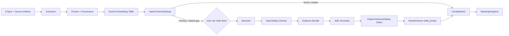

# P03 — Search, Brew, Candidate, Ranking & ADK Contracts

> **Trạng thái:** IN REVIEW tại P03<br>
> **Nguồn pattern:** WSIC cho embedding/Brew/ADK; FastChat cho pairwise ranking concepts. GON thiết kế lại trust boundary theo Gate 0.

## 1. Pipeline chuẩn



Search không được kết thúc bằng danh sách trống không giải thích. Mọi đường đều cho ra một verdict/action ở P02.

## 2. Embedding contract

| Thuộc tính | Contract P03 |
|---|---|
| Profile | `gon-semantic-v1` |
| Provider model mặc định | `gemini-embedding-001` |
| Dimensions | **768** cố định cho profile |
| Task | `SEMANTIC_SIMILARITY` cho artifact/module matching trong profile v1 |
| Chuẩn hóa | L2 normalize mọi vector trước khi lưu |
| Distance | Cosine; inner product chỉ dùng khi đã chứng minh tương đương trên vector normalized |
| Lưu kèm | model ID, model/config version, task, dimensions, chunk hash, index version |
| Public API | Không trả raw vector |

### 2.1 Chunking

- Tách theo cấu trúc nguồn trước: heading/trang/timestamp/đoạn.
- Mục tiêu 500–800 token/chunk, overlap tối đa 80 token; không cắt giữa một claim ngắn nếu tránh được.
- Prefix ngữ cảnh gồm title/section nhưng vẫn giữ locator của span gốc.
- Không embed artifact ở trạng thái `metadata_only` như thể đã có nội dung chính. Metadata có thể tạo một chunk loại `metadata` có trọng số thấp và ghi rõ coverage.
- Nội dung bị policy chặn không vào index có thể gợi ý cho user khác.
- Dedup theo `contentSha256` trong phạm vi index/profile để tránh embed lại cùng chunk bất biến.

### 2.2 Re-embedding

- Thay model/dimensions/task/chunking tạo `embeddingProfile` mới.
- Backfill vào embedding records/index mới; search chỉ chuyển alias sau eval.
- Không trộn vector của hai profile trong cùng một phép so sánh.
- ModuleVersion cũ vẫn đọc được dù index cũ retired.

## 3. Hybrid Search và verdict

### 3.1 Tập ứng viên và quyền

Tìm trên:

1. ModuleVersion private của chính chủ project;
2. ModuleVersion `internal_reviewed` trong catalog Alpha;
3. Source chunks của project để giải thích matched/missing, không biến artifact chưa thành module thành kết quả học hoàn chỉnh.

Authorization/visibility/publication filter áp trước khi lấy top-k. Không truy vấn toàn cục rồi mới lọc ở client.

### 3.2 Signal

`search-policy-v0` lưu các thành phần nội bộ:

- `vectorScore`: cosine tốt nhất có trọng số theo chunk liên quan;
- `lexicalScore`: title/alias/full-text và exact entities;
- `conceptCoverage`: tỷ lệ concept chính của intent được module bao phủ;
- `specificityScore`: độ phủ thực thể/điều kiện đặc thù, tránh hai chủ đề cùng “học tập” bị coi là trùng;
- `qualityScore`: citation/review/completion evidence nội bộ ở mức module;
- `intentAmbiguity`: mức input có thể dẫn tới nhiều mục tiêu khác nhau;
- `safetyDecision`: allow/clarify/block.

Công thức seed để fixture/eval ban đầu:

```text
hybrid = 0.50*vector + 0.15*lexical + 0.25*conceptCoverage
       + 0.05*specificity + 0.05*quality
```

Đây không phải điểm chất lượng hiển thị cho user và chưa phải ngưỡng production cuối.

### 3.3 Verdict seed `search-policy-v0`

| Verdict | Điều kiện seed | Hành động |
|---|---|---|
| `blocked_by_policy` | Safety gate chặn input/kết quả | Dừng an toàn, lý do nhóm |
| `needs_clarification` | `intentAmbiguity >= 0.70` hoặc artifact usable quá ít | Tối đa 3 câu hỏi ngắn |
| `found` | `hybrid >= 0.78`, `vector >= 0.82`, `conceptCoverage >= 0.80`, không thiếu concept critical | Mở Output Explorer |
| `related` | `hybrid >= 0.52` hoặc coverage `0.35–0.79` | Học phần có sẵn hoặc Brew phần thiếu |
| `missing` | Không đạt related | Đề xuất Brew/sửa input |

Trước release VS1, P04/P05 phải hiệu chuẩn bằng bộ truy vấn VI/EN được gán nhãn gồm found/related/missing/clarify/blocked, chủ đề hẹp/rộng và artifact partial. Nếu eval cho thấy seed gây false-found, phải nâng gate/coverage trước khi mở cho alpha users.

### 3.4 Explanation

Mỗi result trả:

- `matchedConcepts`, `missingConcepts`;
- `reasonCodes`: `same_core_concepts`, `same_source_topic`, `covers_prerequisites`, `missing_artifact_outcome`, `different_depth`, `source_needs_review`;
- source/review status.

Không hiển thị một phần trăm “đúng” duy nhất từ vector score.

## 4. Candidate generation

### 4.1 Nguồn candidate

Candidate có thể đến từ:

- ModuleVersion có sẵn phù hợp;
- cùng một Module Graph được chiếu thành các learning path/format khác nhau mà graph hỗ trợ thật;
- template output có rubric/artifact khác nhau;
- candidate hợp nhất từ Arena merge;
- ở VS5, internal trend chỉ là tín hiệu xếp hạng bổ sung, không tự tạo candidate ngoài catalog được phép.

### 4.2 Khác nhau thật và dedupe

Một candidate được coi là khác khi khác ít nhất một trục có ý nghĩa: outcome, format, độ sâu, artifact, đối tượng áp dụng hoặc hành động cuối.

Dedupe khi đồng thời:

- semantic fingerprint cosine `> 0.92`;
- concept set gần như trùng;
- format/outcome/artifact không khác.

Ngưỡng 0.92 là seed của `candidate-policy-v0`, phải kiểm bằng fixture trước release.

### 4.3 Không đủ 10

Nếu `actualCount < 10`, API trả số thật và `shortfallReasonCodes` như:

- `topic_too_narrow`
- `insufficient_reviewed_sources`
- `formats_not_supported_by_graph`
- `duplicates_removed`
- `safety_filtered`
- `generation_quota_reached`

Không tạo thêm tiêu đề trùng để đạt số 10. User vẫn có thể Brew biến thể hoặc sửa input khi policy cho phép.

## 5. Ranking rules v1

### 5.1 Tầng cứng

Loại candidate nếu:

- không có quyền xem;
- bị policy hidden;
- thiếu prerequisite bắt buộc mà không có remediation;
- vượt hard time constraint user đã đặt;
- source status không đạt mức tối thiểu cho loại claim/chủ đề rủi ro.

### 5.2 Nhóm tín hiệu

RankingSnapshot lưu các nhóm đã chuẩn hóa 0–1:

- `relevance`
- `conceptCoverage`
- `sourceQuality`
- `modeFit`
- `timeFit`
- `personalFit` — chỉ khi consent footprint đang bật
- `internalLearningTrend` — 0 trong VS1/VS2 cho tới VS5
- `diversityAdjustment`

Trọng số mode là cấu hình versioned phía server. API không hứa trọng số là sở thích khoa học tuyệt đối; explanation giải thích nhóm tín hiệu đứng đầu.

### 5.3 Mode profiles seed

| Mode | Ưu tiên cao hơn | Giảm ưu tiên |
|---|---|---|
| Deep Mastery | concept coverage, source quality, prerequisite depth | thời lượng cực ngắn, entertainment-only |
| Apply at Work | transfer/case artifact, outcome thực dụng | lý thuyết không có áp dụng |
| Create / Publish | artifact outcome, teach-back/media/game template | chỉ đọc/quiz |
| Fast & Entertaining | time fit, easy task/game nhẹ | độ khó/thời lượng lớn; vẫn phải có core check |
| Prove & Impact | Boss/evidence, real-world task | artifact chỉ tự khai không rubric |

### 5.4 Personalization off

Khi tắt:

- `personalFit` bị loại khỏi tính toán và snapshot ghi `personalizationApplied=false`;
- vẫn dùng input/mode/context của phiên hiện tại;
- snapshot cũ không bị sửa lịch sử nhưng UI phải tạo snapshot mới trước khi hiển thị ranking hiện tại;
- xóa footprint không xóa project/journey/proof.

### 5.5 Arena và pairwise rating

VS2 dùng vote để:

- cập nhật personal preference signal có ngữ cảnh;
- tạo internal pairwise dataset theo candidate/module version;
- đề xuất merge.

Rating nội bộ chỉ hiển thị khi đủ trận và có uncertainty. Thuật toán Elo/Bradley–Terry của FastChat là ứng viên port có điều kiện ở P04 sau test vectors; P03 không chốt tham số public leaderboard.

## 6. Brew pipeline

### 6.1 Điều kiện chạy

- Project thuộc user, account active và 18+ attestation hoàn tất.
- Search verdict liên quan còn hiệu lực hoặc user chủ động xin biến thể từ module được phép.
- `brew_enabled=true`; quota còn; không có job active cùng fingerprint.
- User xác nhận; client không tự gọi provider.

### 6.2 Bước máy

| Step | Đầu vào | Đầu ra/gate |
|---|---|---|
| `validate_request` | Project/search/context | Ownership, quota, fingerprint |
| `topic_and_safety_check` | Intent + artifact summaries | allow/clarify/block |
| `build_evidence_bundle` | Artifact chunks + research đã duyệt | Source IDs/locators/rights; không source bịa |
| `generate_module_graph` | Evidence bundle + learning context | Graph schema candidate |
| `design_assessments` | Concepts/outcomes | Rubric và gating hợp lệ |
| `verify_citations` | Graph + sources | Citation coverage/unverified claims |
| `safety_and_policy_review` | Graph | allow/needs review/block |
| `persist_draft` | Valid graph | ModuleVersion `draft_private` |
| `build_candidate_set` | Module/search results | CandidateSet hoặc shortfall reason |

Job có checkpoint sau mỗi step. Retry quay lại step chưa hoàn tất khi an toàn; không chạy lại toàn bộ pipeline đắt tiền nếu output step trước còn hợp lệ.

### 6.3 Evidence/research

- User artifacts là nguồn ưu tiên khi quyền/trích xuất cho phép.
- External research chỉ qua provider/search connector được P03/P05 duyệt về điều khoản, logging và chi phí.
- Mỗi external source lưu URL, retrievedAt, title/publisher nếu biết, locator/span và usage note.
- Generator chỉ nhận source IDs trong bundle; citation verifier đối chiếu claim ↔ source.
- Nội dung web/artifact là dữ liệu không tin cậy: instruction trong nguồn không được coi là lệnh cho agent/tool.

## 7. ADK service contract

### 7.1 Ranh giới

ADK service là worker tính toán, không phải chủ dữ liệu:

- Nhận job command đã xác thực từ GON worker.
- Không nhận Google session của user.
- Không có database credential để ghi/publish trực tiếp.
- Tool chỉ gồm evidence retrieval/research đã allowlist và structured output.
- Mọi output qua schema validator + policy service trước khi persist.

### 7.2 Operations nội bộ

| Contract | Input | Output |
|---|---|---|
| `TopicCheck` | Intent, artifact coverage summaries, policy version | `allow/clarify/block`, reason codes, clarification questions |
| `GenerateModule` | Learning context, evidence bundle, graph schema version | Module Graph candidate + generation metadata |
| `AssessAttempt` | Node/rubric, answer/artifact refs đã trích xuất | Criterion outcomes, feedback, confidence |
| `PlanCandidates` (tùy chọn) | Module graph/search summary | Candidate descriptors chưa persist |

Schema máy đọc được nằm tại [`schemas/agent-contracts.schema.json`](schemas/agent-contracts.schema.json).

### 7.3 Model/prompt/version

Mỗi AiRun ghi:

- provider/model ID thực tế được cấu hình;
- agent pipeline và prompt template versions;
- input/output schema versions;
- token/cost units, latency, finish/error code;
- source bundle hash.

Không lưu raw chain-of-thought. Prompt chứa dữ liệu private không được ghi nguyên văn vào log mặc định.

### 7.4 Lỗi đầu ra

- JSON không parse/schema sai: tối đa một repair attempt với lỗi validator đã rút gọn.
- Citation ngoài bundle: reject output.
- Safety block: terminal, không repair để lách policy.
- Provider timeout/5xx: retry theo job policy.
- Thiếu evidence: `needs_input` hoặc graph có unverified labels nếu vẫn an toàn/hữu ích theo policy; không bịa citation.

## 8. Assessment contract

- Rule deterministic chấm choice/reorder trước.
- AI rubric assessment cho text/artifact trả từng criterion, feedback và confidence.
- `confidence < 0.70`, artifact rủi ro cao hoặc integrity signal mạnh → `pending_human_review`; ngưỡng là seed phải eval.
- Tương đồng với nguồn/copy-paste không tự kết luận gian lận; hệ thống yêu cầu giải thích/transfer bổ sung hoặc human review.
- AI assessment không tự nâng Proof lên Issuer-verified.
- Human reviewer quyết định tạo AssessmentResult mới và audit, không sửa result cũ.

## 9. Cost/quota mặc định đề xuất

Các số sau là **giới hạn Alpha để PO duyệt tại D-P03-12**, không phải giá nhà cung cấp:

- Brew: tối đa 5 job/người/ngày, 2 job active/người, 1 active/fingerprint.
- Extraction: tối đa 20 artifact processing/người/ngày.
- Search attempts: 60/người/giờ.
- Arena votes: 100/người/ngày.
- Job Brew: tối đa 3 attempts cho lỗi retryable, deadline tổng 15 phút.
- Mỗi job có token/cost budget cấu hình theo môi trường; vượt budget chuyển `failed_terminal` với mã `AI_BUDGET_EXCEEDED`, không tiếp tục gọi provider.

Operator dashboard/alert và kill switch là yêu cầu P04/P05 trước khi mời user thật.
