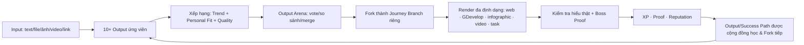

# Requirement bổ sung GON V2.1 — Trending Output, Personalized Fork & Output Arena

**Phiên bản:** 2.1-draft · **Ngày:** 22/10/2026 · **Mở rộng:** [`GON-ORG-PRODUCT-SPEC-18PLUS.md`](GON-ORG-PRODUCT-SPEC-18PLUS.md)  
**Phạm vi:** GON.org cho người trưởng thành 18+ · **Trạng thái:** requirement đích; prototype hiện tại mới có search/Brew/Coach-vs-Quest cục bộ, chưa có trend thật, cộng đồng, fork công khai hay phần thưởng thật.

## 1. Tuyên ngôn bổ sung

> Một input trên GON không nên cho ra **một đáp án duy nhất**. Nó phải mở ra **ít nhất 10 hướng output** khác nhau, được xếp hạng bởi sự kết hợp của **xu hướng xã hội đang lên**, **dấu chân học tập cá nhân** và **chất lượng tri thức**. User bình chọn, chọn một hướng — hoặc hợp nhất nhiều hướng — rồi **Fork** thành hành trình riêng. Hành trình ấy được học qua game GDevelop, web tương tác, infographic, hình ảnh, video và nhiệm vụ đời thật; chỉ khi user chứng minh được mình hiểu và làm được thì tiến bộ, danh tiếng và phần thưởng mới được ghi nhận.

Chuỗi giá trị mới:



GON học cơ chế khám phá của TikTok/Facebook và cơ chế đối đầu của Arena, nhưng **không tối ưu cho thời gian lướt vô hạn**. Thuật toán của GON phải tối ưu cho lựa chọn tốt tiếp theo, mức hiểu thật, sản phẩm tạo ra và tác động có bằng chứng.

## 2. Khái niệm chuẩn

| Khái niệm | Định nghĩa bắt buộc |
|---|---|
| **Input Event** | Một lần user đưa text/file/ảnh/video/link cùng mục tiêu và ngữ cảnh vào GON. Input là truy vấn, đồng thời là Source Artifact có provenance. |
| **Output Candidate** | Một hướng kết quả/học tập cụ thể được đề xuất từ input: giải thích sâu, lộ trình, game, infographic, video, thử thách thực hành, nghiên cứu phản biện, nội dung sáng tạo, nhiệm vụ cộng đồng… |
| **Personal Learning Footprint** | Dấu chân học tập được user đồng ý ghi: mục tiêu, trình độ, output đã chọn, vote, thời gian học có ý nghĩa, mức hoàn thành, quiz/mastery, Fork, sản phẩm, proof và phản hồi “không quan tâm”. |
| **Trend Signal** | Tín hiệu một topic/output đang được cộng đồng quan tâm và tạo giá trị nhanh hơn bình thường; không chỉ đếm view/like. |
| **Output Arena** | Bề mặt so sánh hai hoặc nhiều output/model/agent để user vote theo tiêu chí rõ ràng; kết quả dùng cho cá nhân hoá và xếp hạng chất lượng. |
| **Journey Fork/Branch** | Bản sao có lineage của một topic/output/Success Path để user phát triển riêng, tương tự Fork/Branch trên GitHub. |
| **Branch Commit** | Một bước học có ý nghĩa trong branch: hoàn thành quest, trả lời kiểm chứng, tạo artifact, phản tư, sửa hiểu lầm hoặc proof được ghi nhận. Không biến mọi click thành commit. |
| **Success Path** | Hành trình đã công khai có bằng chứng: điểm bắt đầu, mindset/quyết định, hành động, thất bại/điều chỉnh, artifact, kết quả và proof. Người khác có thể Fork nhưng không được hứa sẽ sao chép nguyên vẹn kết quả. |
| **Creator Attribution Graph** | Đồ thị ghi công nối input gốc, nguồn, người tạo module, người cải tiến/Fork và người xác minh; dùng cho reputation và mọi phân bổ thưởng tương lai. |
| **Canonical Module Graph** | Nội dung học trung lập về định dạng gồm outcome, concept, nguồn, quest, media, assessment và rubric; từ đây render sang web/GDevelop/infographic/video/task. |

## 3. Từ một input phải sinh 10+ output có hướng khác nhau

### 3.1 Nhóm output tối thiểu

Sau khi hiểu input, hệ thống tìm trong kho và/hoặc Brew để tạo tối đa tính đa dạng, mục tiêu hiển thị **từ 10 output ứng viên trở lên** khi chủ đề đủ rộng. Chúng được gom thành các cụm dễ chọn, không đổ một danh sách dài gây quá tải:

1. **For You Now** — phù hợp nhất với mục tiêu, trình độ, thời gian và footprint hiện tại.
2. **Trending in Society** — đang lên trong cộng đồng/ngách liên quan.
3. **Deep Mastery** — đi sâu vào bản chất, nguồn gốc, phương pháp và tranh luận.
4. **Fast & Entertaining** — game, câu chuyện, hình ảnh hoặc video ngắn để vào đề nhẹ nhàng nhưng vẫn dẫn tới core value.
5. **Apply & Create** — nhiệm vụ, sản phẩm, dự án, nội dung sáng tạo hoặc ứng dụng nghề nghiệp.
6. **Prove & Impact** — Boss Proof, hành động cộng đồng, mentor, đóng góp module hoặc kiểm chứng chuyên gia.

Các output mẫu từ cùng một input có thể là:

- Bản đồ khái niệm 10 phút;
- Game GDevelop mô phỏng cơ chế của chủ đề;
- Infographic một trang;
- Video script/storyboard 60–90 giây;
- Chuỗi ảnh/comic giải thích;
- Lộ trình 7 ngày;
- Tranh luận hai quan điểm có nguồn;
- Bài kiểm tra chẩn đoán và sửa hiểu lầm;
- Thử thách tạo sản phẩm;
- Phân tích vì sao chủ đề đang viral;
- Lộ trình trở thành creator/KOL trong ngách;
- Nhiệm vụ tác động thật và Boss Proof.

### 3.2 Mỗi Output Card phải hiển thị

- Tiêu đề, lời hứa học tập và kết quả/artifact cuối;
- Định dạng chính, thời lượng ước tính, độ khó, điều kiện tiên quyết;
- `Personal Fit`, `Trend`, `Source Quality`, `Mastery Potential` và lý do ngắn “Vì sao gợi ý cho bạn?”;
- Số nguồn/citation và trạng thái grounding;
- Creator/lineage, số Fork và số người đã hoàn thành có proof — khi có dữ liệu thật;
- XP dự kiến chỉ sau hành động đạt rubric, không thưởng chỉ vì bấm mở;
- Hành động: **Học ngay**, **Đưa vào Arena**, **Fork**, **Merge với output khác**, **Lưu**, **Không quan tâm**, **Báo cáo**.

### 3.3 Ràng buộc chất lượng candidate

- Không tạo 10 bản gần giống nhau chỉ đổi tiêu đề; các output phải khác nhau về mục tiêu, độ sâu, định dạng hoặc hành động.
- Output chưa có nguồn/grounding phải gắn nhãn **AI draft / chưa kiểm chứng**.
- Output nguy hiểm, sai lệch nghiêm trọng, vi phạm bản quyền hoặc không phù hợp chính sách 18+ phải bị loại trước khi xếp hạng trend.
- User được đổi trọng tâm bằng các thanh điều khiển: **Xu hướng ↔ Chuyên sâu**, **Giải trí ↔ Mastery**, **Quen thuộc ↔ Khám phá**, **Ngắn ↔ Dài hạn**.

## 4. Hồ sơ và dấu chân cá nhân hoá

### 4.1 Persona là “chế độ học”, không phải nhãn cố định

Cùng một người có thể là tiến sĩ khi nghiên cứu buổi sáng, creator khi làm nội dung buổi chiều và người học giải trí vào buổi tối. GON dùng **Learning Mode** do user khai/chọn, kết hợp footprint được đồng ý, thay vì đóng khung user vĩnh viễn vào một nghề.

| Chế độ tiêu biểu | Output được ưu tiên | Tiêu chí Arena thường thắng |
|---|---|---|
| **Researcher / Tiến sĩ / Chuyên gia** | Nguồn nguyên cấp, phương pháp, mâu thuẫn trong tài liệu, research gap, replication, peer debate | Chính xác, nguồn mạnh, lập luận sâu, giới hạn rõ |
| **KOL / Creator** | Góc kể chuyện, short video, challenge cộng đồng, phân tích trend, lịch nội dung, artifact có thể xuất bản | Dễ lan truyền nhưng vẫn đúng, có hook, có bằng chứng và giá trị riêng |
| **Người đi làm** | Lộ trình 15–30 phút, case công việc, template, sản phẩm dùng ngay, mentor/roadmap nghề | Thực dụng, tiết kiệm thời gian, áp dụng được |
| **Người học phổ thông / giải trí** | Game, truyện, video/hình ảnh, ví dụ đời sống, nhiệm vụ nhỏ | Dễ vào, vui, ít thuật ngữ, có cảm giác tiến bộ nhanh |
| **Community Hero** | Hiến máu/phục vụ, thử thách nhóm, sự kiện thật, proof tác động | An toàn, khả thi ngoài đời, lan tỏa có trách nhiệm |

### 4.2 Tín hiệu được phép dùng

- Khai báo trực tiếp: nghề/vai trò, mục tiêu, chủ đề, trình độ tự đánh giá, định dạng yêu thích, thời lượng mỗi phiên, ngôn ngữ, nhu cầu tiếp cận.
- Hành vi trong GON: tìm kiếm, mở, lưu, chọn output, vote kèm lý do, hoàn thành quest, điểm truy hồi, ôn lại sau giãn cách, Fork, merge, artifact, proof, share công khai, ẩn/báo cáo.
- Ngữ cảnh phiên: mục tiêu hiện tại, thiết bị, thời lượng khả dụng và chế độ học user đang chọn.

### 4.3 Quyền kiểm soát bắt buộc

- User xem, sửa, tắt và xoá footprint/cá nhân hoá; tắt cá nhân hoá không làm mất quyền học nội dung lõi.
- Không suy luận hay dùng thuộc tính nhạy cảm như tình trạng bệnh, chính trị, tôn giáo, xu hướng tính dục để xếp hạng khi không có cơ sở pháp lý và đồng ý riêng.
- Không mặc định coi học hàm/KOL tự khai là đã xác minh; credential hiển thị công khai phải có quy trình đối chiếu.
- Mỗi gợi ý có giải thích tối thiểu, ví dụ: “Đang tăng Fork 24 giờ qua + hợp mục tiêu Creator + cần 20 phút”.

## 5. Thuật toán gợi ý và xu hướng thật

### 5.1 Pipeline hai tầng

1. **Candidate Retrieval:** hợp nhất các pool từ vector search 768D, đồ thị topic/Fork, creator/guild user theo dõi, topic đang trend, nội dung evergreen chất lượng cao và một phần khám phá có kiểm soát.
2. **Ranking & Reranking:** chấm từng output cho từng user, áp quality/safety gate, loại trùng lặp, đảm bảo đa dạng định dạng/quan điểm, rồi giải thích thứ hạng.

### 5.2 Nhóm tín hiệu xếp hạng

Điểm minh hoạ — trọng số production phải cấu hình, A/B test và lưu snapshot để tái lập:

```text
FinalScore =
  0.24 × RelevanceToInputAndGoal
+ 0.20 × PersonalFit
+ 0.18 × PredictedLearningGain
+ 0.14 × QualityWeightedTrend
+ 0.10 × SourceAndGroundingQuality
+ 0.07 × CreatorTrustAndProvenImpact
+ 0.07 × DiversityNoveltyFormatTimeFit
− penalties(clickbait, duplication, misinformation, manipulation, unsafe, dropout)
```

`PredictedLearningGain` phải học từ hoàn thành, cải thiện trả lời và retention; không dùng thời gian xem đơn độc làm proxy cho học tập.

### 5.3 Trend của GON khác trend giải trí thuần tuý

Một topic/output chỉ “lên xu hướng” khi có **tốc độ tăng của người thật và hành động học thật**, gồm:

- Số user độc lập bắt đầu học, Fork, hoàn thành module và tạo artifact theo cửa sổ 1–6 giờ, 24 giờ, 7 ngày;
- Tỷ lệ biến lượt mở thành hoàn thành/mastery/proof;
- Fork từ các branch khác nhau, lượt merge/cải tiến và output con chất lượng;
- Like/share/comment có trọng số thấp hơn hoàn thành/proof và bị giảm khi phát hiện bot/vòng lặp;
- Đánh giá Arena, review có rubric và nguồn vẫn còn hiệu lực;
- Độ bền: phân biệt **Emerging**, **Rising**, **Sustained** và **Evergreen**.

UI phải cho thấy cơ sở trend và mẫu dữ liệu, ví dụ “+128% lượt Fork hoàn thành trong 24 giờ, 312 learner độc lập”. Không hiển thị phần trăm gây ấn tượng khi mẫu quá nhỏ.

Dữ liệu trend bên ngoài TikTok/Facebook/YouTube/Google chỉ được dùng qua API/phương thức được phép và đúng điều khoản; GON không yêu cầu scrape trái phép hay mua dữ liệu cá nhân.

### 5.4 Chống bong bóng và thao túng

- Giới hạn tỷ lệ nội dung chỉ vì đang viral; luôn giữ slot cho chuyên sâu, evergreen và khám phá ngoài vùng quen thuộc.
- Giảm hạng nội dung có view cao nhưng bỏ học, trả lời sai hoặc bị báo cáo.
- Dò bot, tài khoản clone, vote ring, Fork rỗng, proof giả và tương tác mua bán.
- Trend không được khuếch đại nội dung y tế/tài chính/chính trị chưa qua cổng nguồn và moderation phù hợp mức rủi ro.

## 6. Output Arena: user bình chọn để AI và output “đua top”

### 6.1 Trải nghiệm

- User chọn hai output bất kỳ, hoặc hệ thống ghép cặp có độ bất định cao để học sở thích nhanh.
- Chế độ **Blind Arena** ẩn model/agent/creator trong vòng chấm chất lượng; chế độ **Named Arena** cho chọn model/creator công khai.
- Nút vote: **Trái tốt hơn**, **Phải tốt hơn**, **Hoà**, **Cả hai chưa tốt**, **Merge hai hướng**.
- Sau vote, user có thể chấm nhanh theo trục: dễ hiểu, sâu, vui, thực dụng, đáng tin, hợp với tôi, muốn làm ngay.
- Kết quả cá nhân hoá xuất hiện ngay: “Đã ưu tiên thêm output dạng game mô phỏng và giảm bài đọc dài trong phiên này”.
- User có thể fork bên thắng, fork bản merge hoặc yêu cầu Brew lại từ điểm mạnh của cả hai.

### 6.2 Xếp hạng công bằng

- Dùng mô hình cặp như Elo/Bradley–Terry kèm khoảng tin cậy và số trận; không xếp hạng tuyệt đối chỉ bằng tỷ lệ thắng thô.
- Có leaderboard riêng cho: toàn hệ, theo ngách, theo Learning Mode, theo định dạng và **cá nhân của user**.
- Model/agent/prompt version cũng được thi đấu trên benchmark có rubric, chi phí, độ trễ, an toàn và learning gain; vote sở thích không thay thế kiểm chứng đúng/sai.
- Xáo trộn trái/phải, ẩn danh khi cần, giới hạn vote lặp, phát hiện phối hợp gian lận.
- Output của chuyên gia có thể nhận review chuyên môn riêng; không để số đông biến khẳng định sai thành “verified”.

## 7. Mỗi hành trình là một Fork có thể phát triển độc lập

### 7.1 Hành vi giống GitHub nhưng cho học tập

- **Fork:** sao chép output/Success Path tại một version vào không gian riêng; hiển thị upstream và tác giả gốc.
- **Branch:** thử một hướng khác mà không phá hành trình chính, ví dụ “học sâu học thuật” và “làm video KOL” từ cùng topic.
- **Commit:** ghi bước tiến có artifact/câu trả lời/proof hoặc quyết định quan trọng.
- **Diff:** so sánh hai branch về nguồn dùng, concept đã nắm, hành động, artifact và kết quả.
- **Merge:** đưa module/insight từ branch khác vào branch của mình; nếu quan điểm mâu thuẫn, hệ thống mở “conflict” để user đối chiếu nguồn thay vì lặng lẽ ghi đè.
- **Pull upstream:** nhận thông báo khi module gốc sửa lỗi, thêm nguồn hoặc thay rubric.
- **Publish:** công khai branch xuất sắc thành Success Path/template cho người khác Fork.
- **Archive/Delete:** dữ liệu riêng tư bị xoá phải được tombstone khỏi lineage công khai mà không phá attribution tối thiểu đã công bố hợp lệ.

### 7.2 Gợi ý bước tiếp theo trong branch

Ở mỗi node, GON đề xuất 3–10 bước tiếp theo dựa trên:

- Concept chưa nắm và lỗi hiểu vừa bộc lộ;
- Mục tiêu cuối của branch;
- Artifact còn thiếu để đạt Boss Proof;
- Output đang trend nhưng liên quan thật;
- Success Path của người có điểm bắt đầu tương tự;
- Thời gian và định dạng còn phù hợp.

User luôn thấy mình đang ở đâu trên cây hành trình, branch nào là thử nghiệm, branch nào đã có proof.

## 8. Trend tạo cơ hội cho creator trở thành KOL trong ngách

### 8.1 Từ một input tốt đến hiện tượng lan truyền

Khi một topic/output được nhiều người học thật, Fork tiếp, hoàn thành, tạo artifact và chia sẻ có ghi công, creator có cơ hội nổi lên rất nhanh — tương tự cách một hiện tượng văn hoá như *Gangnam Style* bùng nổ sau một đêm. GON biến cơ hội ấy thành đường đi có thể quan sát:

```text
Input/insight gốc
→ Output dễ bắt đầu nhưng có core value rõ
→ Cộng đồng Arena chọn và cải tiến
→ Nhiều Journey Fork tạo kết quả thật
→ Success Path có proof
→ Creator trở thành tiếng nói đáng tin trong ngách
→ Cơ hội danh tiếng, hợp tác và doanh thu hợp pháp ngoài XP
```

### 8.2 Reputation và thưởng không chỉ dựa vào like/share

Creator Score phải ưu tiên:

- Learner độc lập hoàn thành và tăng mastery;
- Fork tạo artifact/proof chất lượng;
- Tỷ lệ người học quay lại/ôn đúng hạn;
- Review Arena và chuyên gia có rubric;
- Tác động đời thật được ghi nhận;
- Tính bền vững sau giai đoạn viral.

XP là điểm nội bộ. Token, tiền, chia sẻ doanh thu hoặc marketplace — nếu triển khai — là hệ riêng cần điều khoản creator, bản quyền, thuế/KYC khi áp dụng, chống rửa tương tác và tư vấn pháp lý. **GON không được hứa mọi creator sẽ giàu hoặc thành triệu phú.** Thông điệp đúng là: nội dung tạo giá trị học thật có cơ hội được khám phá, ghi công và thương mại hoá minh bạch.

### 8.3 Success Path phải chống “thần thoại thành công”

Một Success Path công khai phải có:

- Điểm bắt đầu và nguồn lực thật;
- Chuỗi quyết định/hành động theo thời gian;
- Thất bại, điểm rẽ và điều đã sửa;
- Artifact, số liệu và proof có cấp xác minh;
- Phần nào là may mắn/bối cảnh, phần nào có thể học lại;
- Cảnh báo survivorship bias và điều kiện không nên sao chép.

Badge “Niche KOL/Trusted Creator” dựa trên tác động học và độ tin cậy bền vững, không chỉ follower. Học hàm/chứng chỉ nghề nghiệp chỉ hiển thị đã xác minh sau đối chiếu issuer.

## 9. Học theo trend nhưng phải hiểu core value thật

Trend là cửa vào, không phải bằng chứng đã học. Để nhận XP lớn, badge, quyền công khai Success Path hoặc thưởng creator, user phải qua các cổng hiểu thật phù hợp mức độ:

1. **Diagnostic:** kiểm tra điểm bắt đầu và hiểu lầm phổ biến.
2. **Retrieval:** tự nhớ/giải thích trước khi xem đáp án.
3. **Teach-back:** giải thích bằng lời của mình cho một đối tượng cụ thể.
4. **Transfer:** áp dụng vào tình huống mới không có trong ví dụ.
5. **Create:** tạo artifact/game/video/bài viết/hành động của riêng mình.
6. **Critique:** chỉ ra giới hạn, nguồn yếu hoặc điểm trend đang thổi phồng.
7. **Delayed Review:** ôn và trả lời lại sau giãn cách để đo retention.
8. **Boss Proof:** nộp kết quả có rubric, quá trình và provenance.

Yêu cầu chống học vẹt/copy-paste:

- Câu hỏi biến thể và follow-up Socratic dựa trên chính câu trả lời của user;
- Cho phép dùng AI hỗ trợ nhưng phải khai báo ở artifact công khai/trọng yếu;
- Lưu version/quá trình tạo artifact, không chỉ nộp bản cuối;
- Khi remix nội dung trend, user phải ghi nguồn, nói rõ mình thay đổi gì và hiểu core value nào;
- Phát hiện sao chép chỉ là tín hiệu để hỏi thêm/đánh giá lại, không tự động kết tội bằng một điểm AI-detector;
- Trạng thái mastery theo concept đi từ **Exposed → Recall → Apply → Create → Teach**, không chỉ “đã xem”.

## 10. Vai trò của GDevelop và render đa chiều

### 10.1 Một module, nhiều bề mặt học

Mọi output được lưu trước dưới dạng **Canonical Module Graph**, rồi render thành:

- Web interactive lesson/quest map;
- **Game GDevelop** có scene, object, event, variable, lựa chọn rẽ nhánh, mô phỏng và feedback;
- Infographic/poster và chuỗi hình ảnh/comic;
- Video script, storyboard, caption và asset list; tích hợp render video khi có pipeline phù hợp;
- Flashcards, quiz, reorder và bài tập truy hồi;
- Task/checklist đời thật;
- Slide/mini-presentation;
- Phiên bản text/âm thanh dễ tiếp cận cho người không muốn hoặc không thể chơi game.

### 10.2 Vì sao GDevelop làm nội dung “đa chiều” hơn

- Biến khái niệm trừu tượng thành biến số và hệ quả nhìn thấy được;
- Cho user ra quyết định, sai an toàn, nhận feedback và thử chiến lược khác;
- Biến quy trình thành map/quest, tranh luận thành role-play, hệ thống thành simulation;
- Thu thập event học tập có cấu trúc: lựa chọn, lỗi, thời gian, gợi ý đã dùng, artifact và Boss result;
- Cho creator/user sửa scene/event để Fork thật sự sáng tạo, không chỉ thay ảnh bìa.

### 10.3 Requirement cho GDevelop generator/export

- Module JSON có schema và version; generator chọn template mechanic theo outcome: phân loại, ghi nhớ, khám phá, mô phỏng, quyết định, xây dựng, nhập vai hoặc quản trị nguồn lực.
- Sinh scene/events/variables/asset manifest có credit và license; project mẫu phải mở/chạy được trong test tự động trước khi gọi là one-click export.
- Mọi game gửi event đã xác thực về GON; server quyết định XP/proof chính thức và chống cộng lặp bằng idempotency.
- Thay đổi trong GDevelop trở thành Branch Commit mới; có thể so sánh và merge như các format khác.
- Mỗi game bắt buộc có learning outcome, hướng dẫn, trạng thái nguồn và đường thoát sang bản web/text tương đương.

## 11. Bề mặt sản phẩm bắt buộc

1. **Output Explorer:** sau input, hiển thị 10+ output theo cụm cùng bộ lọc/điều khiển cá nhân hoá.
2. **Output Arena:** so sánh/vote/merge, xem leaderboard và lý do xếp hạng.
3. **Trend Feed có mục đích học:** tab For You, Rising, Deep, Creator, Guild; mỗi card có CTA học/Fork thay vì chỉ xem tiếp.
4. **Journey Graph:** cây Fork/Branch/Commit, upstream, diff và merge.
5. **Success Path Page:** câu chuyện, bằng chứng, các điểm rẽ, Fork button và cảnh báo bối cảnh.
6. **Creator Studio:** analytics theo completion/mastery/Fork/proof, attribution, phiên bản và trạng thái moderation/reward.
7. **Personalization Center:** footprint, Learning Mode, dữ liệu suy luận, nút sửa/tắt/xoá.
8. **Mastery & Proof View:** concept nào mới xem, đã nhớ, áp dụng, sáng tạo hoặc dạy lại được.

## 12. Dữ liệu và sự kiện tối thiểu

### 12.1 Entity mới

- `learning_modes`, `preference_profiles`, `learning_footprints`
- `candidate_outputs`, `output_versions`, `output_clusters`
- `arena_matches`, `arena_votes`, `ranking_snapshots`
- `journey_branches`, `branch_commits`, `branch_merges`, `branch_lineage`
- `trend_snapshots`, `trend_features`
- `mastery_states`, `assessment_attempts`
- `creator_attributions`, `creator_scores`, `reward_ledger`
- `media_renders`, `gdevelop_exports`, `game_sessions`

### 12.2 Event contract

Mọi event có `event_id`, `schema_version`, `actor_id` băm/mã hoá phù hợp, `session_id`, `occurred_at`, `input_id`, `output_id`, `branch_id` và consent context. Event tối thiểu:

`input_submitted`, `candidates_generated`, `candidate_impressed`, `candidate_selected`, `candidate_hidden`, `arena_vote_cast`, `outputs_merged`, `journey_forked`, `branch_committed`, `branch_merged`, `module_rendered`, `game_started`, `quest_completed`, `assessment_answered`, `artifact_submitted`, `proof_verified`, `success_path_published`, `creator_reward_accrued`.

Không ghi nội dung riêng tư vào analytics khi chỉ cần ID/đặc trưng đã giảm định danh.

## 13. Functional requirements và acceptance criteria

| ID | Requirement | Acceptance criteria tối thiểu |
|---|---|---|
| FR-OUT-01 | Sinh danh sách output ứng viên đa dạng từ một input | Chủ đề đủ rộng có ≥10 output thuộc ≥4 cụm và ≥3 định dạng; output trùng ngữ nghĩa bị gom/loại |
| FR-OUT-02 | Mỗi output có metadata chọn lựa | Card có format, thời lượng, độ khó, fit/trend/quality, source status, artifact cuối |
| FR-PER-01 | Học từ footprint có đồng ý | Sau khi user chọn/vote/hoàn thành, ranking phiên sau thay đổi có giải thích; tắt cá nhân hoá thì không dùng footprint |
| FR-PER-02 | Learning Mode thay đổi kết quả | Cùng input ở Researcher/KOL/Entertainment cho top output khác nhau có lý do kiểm chứng được |
| FR-TREND-01 | Trend dựa trên hành động học thật | Trend snapshot có cửa sổ thời gian, unique learner, completion/Fork/proof; like/share không thể tự đưa output chưa qua quality gate lên top |
| FR-TREND-02 | Giải thích trend | UI hiển thị tín hiệu chính và cỡ mẫu; mẫu nhỏ bị gắn “tín hiệu sớm” |
| FR-ARENA-01 | Vote cặp và merge | User vote trái/phải/hoà/cả hai tệ/merge; vote cập nhật personal ranking và được ghi audit |
| FR-ARENA-02 | Leaderboard có độ tin cậy | Điểm cặp có số trận/khoảng tin cậy; leaderboard có thể lọc theo ngách, mode và format |
| FR-FORK-01 | Fork output/Success Path | Tạo branch riêng trong tối đa hai thao tác chính, giữ upstream/version/attribution; mặc định private |
| FR-FORK-02 | Commit/diff/merge hành trình | So sánh được concept/quest/artifact giữa hai branch và merge có bước xử lý mâu thuẫn nguồn |
| FR-LEARN-01 | Cổng hiểu thật | Badge/Proof lớn không được cấp chỉ bằng xem/click; phải đạt retrieval/transfer/artifact theo rubric của module |
| FR-LEARN-02 | Chống sao chép trend | Artifact công khai có nguồn, khai báo AI/remix, phần giải thích core value và thay đổi của tác giả |
| FR-GDEV-01 | Render module đa định dạng | Cùng Canonical Module Graph xuất được web path và GDevelop blueprint/project đã kiểm thử; infographic/video brief dùng cùng source |
| FR-GDEV-02 | Game telemetry an toàn | Quest/Boss event có idempotency; sửa điểm ở client không tạo XP/proof chính thức |
| FR-CREATOR-01 | Attribution và Creator Score | Mọi output công khai truy được tác giả/nguồn/Fork lineage; score ưu tiên mastery/proof hơn like/share |
| FR-CREATOR-02 | Reward minh bạch | XP tách khỏi token/tiền; mọi khoản thưởng có ledger, điều kiện, chống gian lận và không hứa lợi nhuận |
| FR-SAFE-01 | Kiểm soát trend độc hại | Nội dung rủi ro bị quality/safety gate trước khuếch đại; user báo cáo và appeal được |
| FR-PRIV-01 | Quyền riêng tư footprint | User xem/sửa/xoá/tắt cá nhân hoá; xoá dữ liệu lan truyền sang feature store theo chính sách công bố |

## 14. Chỉ số thành công và guardrail

### North-star

**Verified Learning Gain:** số concept/skill mà user chứng minh được ở mức Apply/Create/Teach và còn giữ sau ôn giãn cách, trên mỗi active learner.

### Chỉ số dẫn dắt

- Input → chọn output → Fork → Branch Commit đầu tiên;
- Tỷ lệ branch hoàn thành Boss Proof;
- Mastery gain trước/sau và delayed retention;
- Output có completion/proof trên mỗi 100 lượt mở;
- Số Fork tạo output con chất lượng;
- Độ đa dạng output được chọn giữa các Learning Mode;
- Arena vote giúp dự đoán completion/mastery tốt đến đâu;
- Creator có downstream learner đạt proof, không chỉ follower/share.

### Guardrail

- Tỷ lệ claim sai/không nguồn lọt trend;
- Bot/gian lận vote, Fork rỗng và proof giả;
- Filter bubble: giảm đa dạng chủ đề/quan điểm theo thời gian;
- Dấu hiệu dùng gây nghiện hoặc áp lực xã hội;
- Rò rỉ dữ liệu riêng tư, đặc biệt sức khỏe/hiến máu;
- Nội dung viral nhanh nhưng dropout/trả lời sai cao.

## 15. Lộ trình triển khai đề xuất

| Giai đoạn | Deliverable | Điều kiện qua cổng |
|---|---|---|
| **V2.1 Prototype** | 10+ output card, Learning Mode sliders, footprint local, Arena vote làm đổi ranking demo, Journey Fork graph cục bộ | Ghi rõ trend là dữ liệu mẫu; test được các persona cho kết quả khác nhau |
| **P1 Internal Trend** | Event backend, rule-based recommender, trend từ completion/Fork thật, branch/version server | Có moderation, consent, anti-bot cơ bản, ranking snapshot |
| **P2 Learning Intelligence** | ML ranking/personal embedding, mastery model, Arena leaderboard theo cohort | Đánh giá offline/online bằng learning gain; có fairness và explainability review |
| **P3 Multi-format Studio** | Canonical Module Graph, GDevelop converter, infographic/video brief, telemetry | Project GDevelop mẫu chạy kiểm thử; asset license và accessibility đạt |
| **P4 Creator Economy** | Success Path marketplace/guild, attribution ledger, reward ngoài XP nếu khả thi | Pháp lý, bản quyền, thuế/KYC khi áp dụng, chống gian lận và điều khoản creator hoàn tất |

## 16. Ví dụ kiểm chứng requirement

### Input: một video/bài viết về hiện tượng viral âm nhạc

- **Researcher Mode** nhận output: phân tích dữ liệu lan truyền, đối chiếu học thuyết truyền thông, nghiên cứu phản biện về yếu tố văn hoá/nền tảng.
- **KOL Mode** nhận output: bóc tách hook 5 giây đầu, storyboard video học thuật, thử thách cộng đồng, lịch đăng và cách đo retention.
- **Entertainment Mode** nhận game nhịp điệu/mô phỏng “một đêm viral” bằng biến số nội dung, thời điểm, mạng lưới và may mắn.
- Ba user Fork ba hướng khác nhau. Nếu hướng game được nhiều người hoàn thành, tạo artifact và Fork tiếp, trend tăng; creator gốc và người cải tiến đều được attribution.
- Trước khi nhận badge “Viral Mechanics”, mọi user phải giải thích vì sao một bản sao giống hệt chưa chắc viral, áp dụng vào một ngách mới và nộp artifact của mình.

Ví dụ này là phép ẩn dụ về cơ hội bùng nổ; GON không cam kết bất kỳ ai sẽ nổi tiếng hay có thu nhập như một hiện tượng toàn cầu.

## 17. Ngoài phạm vi của bản bổ sung này

- Không xây dựng thuật toán sao chép bí mật thương mại của TikTok/Facebook/Arena; chỉ dùng nguyên lý sản phẩm công khai và dữ liệu hợp pháp.
- Không biến XP thành chứng khoán/token có cam kết sinh lời.
- Không dùng trend/vote số đông để xác minh y khoa, học thuật hoặc chứng chỉ.
- Không bắt buộc mọi chủ đề thành game; GDevelop là một renderer mạnh, nhưng user phải có đường học tương đương phù hợp khả năng và sở thích.
- Không công khai hành trình/proof nhạy cảm mặc định để nuôi trend.
